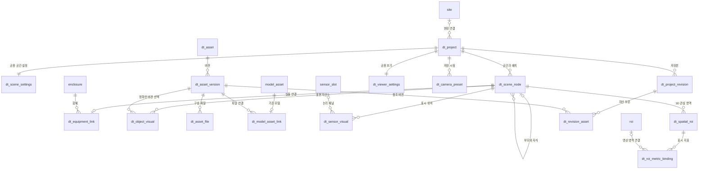

# 디지털 트윈 화면 구성·설정 데이터베이스 설계안

작성일: 2026-10-22  
대상: 현재 DigitalTwin 프론트엔드의 프로젝트 편집기, 사용자 정의 오브젝트, 3D 뷰어  
상태: **백엔드 협의용 설계안. 테이블 생성·마이그레이션·데이터 변경은 수행하지 않음.**

## 1. 권장 구성과 설계 범위

**프로젝트를 다른 PC에서 열어도 동일하게 재현해야 하는 구성은 DB에 저장한다. 모델·이미지 파일 본문은 서버 파일 저장소에, 테마 같은 개인 사용 편의는 브라우저에 저장한다.**

첨부 `DATABASE_SCHEMA_REVIEW.pdf` 전체 50쪽의 41개 DB 객체와 현재 프론트 저장 코드를 대조했다. PDF는 제공된 백엔드 설계의 스냅샷으로 사용했으며, 실제 운영 DB catalog를 조회한 것은 아니다. 아래 `dt_` 테이블·컬럼·상태 코드는 새로 제안하는 이름이다.

권장안은 **화면 구성용 일반 테이블 16개**다. 센서·측정값·임계치·경보·계정 테이블은 추가하지 않는다. 지형 점 하나, 캐비넷 문 하나, 버튼 하나마다 테이블을 만들지 않고, 함께 편집하는 세부 형상은 버전이 있는 JSON으로 묶는다.

| 구분 | 저장 대상 | 권장 저장소 |
| --- | --- | --- |
| 공용 구성 | 프로젝트, 공간 계층, 오브젝트 배치, 모델 선택, 정합, 공용 시점, 관측 표시 설정 | PostgreSQL 일반 테이블 |
| 파일 | OBJ/PLY, MTL, 텍스처, 이미지, 도면, 큰 지형 데이터 | 서버 파일/객체 저장소. DB에는 파일 키와 메타데이터 |
| 개인 편의 | 라이트/다크, 즐겨찾기, 최근 사용, 그림자 성능 옵션 | localStorage. 사용자별 DB 테이블 없음 |
| 편집 복구 | 저장하지 않은 도면·모델 편집 초안, 업로드 대기 파일 | IndexedDB. 서버 저장 완료와 구분 |
| 일시 상태 | 선택한 ROI, 카메라 이동 중 위치, 문 개폐, 팝업, 음원 재생, 실시간 값 | React/Three.js 메모리. 필요할 때만 sessionStorage |
| 운영 데이터 | 센서 등록·교체·설정, 보정, 영상 ROI, 측정, 경보, 청취 기록 | 첨부 PDF의 기존 백엔드 테이블/API |

### 1.1 화면 원칙

- **3D 월드는 뷰포트 전체를 사용한다.** 트리·관측 퀵 메뉴·카메라 버튼·문 제어·패널은 화면 위에 떠 있는 오버레이다.
- 화면의 픽셀 좌표, CSS 클래스, `z-index`, 패널 때문에 줄어든 캔버스 크기는 프로젝트 DB 설정으로 저장하지 않는다. 반응형 위치와 충돌 방지는 프론트 레이아웃 코드의 책임이다.
- 공용으로 사용할 도구와 최초 표시 방식은 저장할 수 있다. 현재 사용자가 패널을 열었는지, 트리에서 무엇을 선택했는지는 공용 설정이 아니다.
- ROI·설비 선택은 카메라와 선택 표시만 변경한다. 프로젝트 저장·모델 버전 변경으로 취급하지 않는다.

### 1.2 범위에서 제외하는 신규 테이블

`dt_sensor`, `dt_sensor_value`, `dt_alarm`, `dt_threshold`, `dt_user_theme`, 버튼별 위치 테이블은 만들지 않는다. 프론트에서 입력하는 값이어도 실제 센서 자세·경보 기준처럼 현장 동작에 영향을 주면 기존 백엔드 도메인이 저장 책임을 가진다.

## 2. 첨부 백엔드 설계와의 역할 분담

### 2.1 41개 객체 전체 분류

| PDF 번호 / 객체 | 프론트 설정 설계에서의 처리 |
| --- | --- |
| 1–3 `app_user`, `role`, `user_role` | 계정/권한 재설계 제외. PDF 3·8–10쪽은 현재 사용자 기능 보류 상태로 설명한다. 개인 UI 설정을 여기에 붙이지 않는다. |
| 4–6 `site`, `enclosure`, `edge_node` | 실제 현장·함체·Edge의 원장. 프로젝트는 site, 화면의 설비는 enclosure에 연결한다. 화면용 건물/층 계층과 구별한다. |
| 7–8 `firmware_release`, `ota_job` | 펌웨어 배포. 프론트 모델 업로드 파일과 혼용하지 않는다. |
| 9–13 `sensor_model`, `sensor_slot`, `sensor`, `sensor_swap_log`, `sensor_config` | 센서 제품·논리 채널·실물·교체·장치 설정의 원본. 표시용 바인딩은 교체에 안정적인 slot을 우선 참조한다. |
| 14 `model_asset` | **이미 존재하는 함체별 3D 모델 버전**. 범용 파일 라이브러리와 연결하되 모델 의미를 대체하지 않는다. |
| 15–16 `sensor_pose`, `calibration` | 모델 기준의 실제 설치 자세와 보정. 화면용 투사 스타일·마커와 분리한다. |
| 17–18 `roi`, `roi_version` | 센서 영상의 관심 영역과 2D 정규화 좌표 버전. 3D 구/표면 ROI와 연결하되 같은 좌표로 간주하지 않는다. |
| 19–21 `roi_switch_attr`, `roi_baseline`, `threshold` | 스위치 판독·기준 영상·경고 규칙. 화면에서 수정해도 저장은 기존 API/테이블이 담당한다. |
| 22–24 `texture_current`, `frame_meta`, `audio_clip` | 최신 센서 영상, 보관 프레임, 음원. 사용자가 올린 정적 외장 텍스처와 분리한다. |
| 25–28 `thermal_roi_stats`, `vision_change_obs`, `switch_state_obs`, `us_detection` | 측정·분석 결과. 화면 설정 DB에 복사하지 않고 조회 API로 받는다. |
| 29–30 `device_heartbeat`, `device_state_event` | 장치 상태/사건. UI의 로딩·연결 표시와 구별한다. |
| 31–32 `alarm`, `alarm_event` | 경고 사건과 흐름. 프론트의 알림 닫기와 업무상 ACK를 구별한다. |
| 33–34 `device_command`, `listen_session` | 장치 명령과 청취 기록. 화면 설정 테이블로 대신하지 않는다. |
| 35 `audit_log` | 설정 저장/배포 감사에도 재사용 가능. API가 기록하며 자동 감사가 이미 구현된 것으로 가정하지 않는다. |
| 36–38 `perf_requirement`, `perf_measurement`, `acceptance_test_run` | 요구·성능 계측·인수 기록. 뷰어 구성과 분리한다. |
| 39–41 `thermal_roi_1m`, `thermal_roi_1h`, `us_detection_1h` | 기존 연속집계 뷰. 그래프 조회 단위로 사용하며 프론트용 집계 테이블을 중복 생성하지 않는다. |

### 2.2 중복되기 쉬운 경계

| 구별할 두 정보 | 기존 백엔드 원본 | 추가할 화면 설정 |
| --- | --- | --- |
| 실제 현장 / 표시할 월드 | `site` | `dt_project`, `dt_scene_settings` |
| 실제 함체 / 장면 속 설비 | `enclosure` | `dt_scene_node`, `dt_equipment_link` |
| 함체의 공간 기준 모델 / 재사용 파일 묶음 | `model_asset` | `dt_asset*`, `dt_model_asset_link` |
| 실제 센서 자세 / 보이는 마커·영상 투사 | `sensor_pose`, `calibration` | `dt_sensor_visual` |
| 분석하는 영상 영역 / 3D에서 표시하는 영역 | `roi`, `roi_version` | `dt_spatial_roi`, `dt_roi_metric_binding` |
| 최신 카메라 이미지 / 외장재 이미지 | `texture_current` | `dt_asset_file`의 정적 텍스처 |
| 경고 판단 기준 / 온도 색상 범위 | `threshold` | `dt_sensor_visual.projection_json`, `dt_viewer_settings` |

PDF에서 확인한 참조 타입은 `site_id`, `enclosure_id`, `edge_node_id`가 `integer`, `slot_id`, `sensor_id`, `model_asset_id`, `pose_id`, `calibration_id`, `roi_id`, `threshold_id`가 `bigint`다. 특히 `sensor_model.model_id`는 **센서 제품 모델**이고 `model_asset.model_asset_id`는 **3D 모델**이다.

PDF 3·12·16쪽 기준으로 한 함체에 여러 Edge가 연결되고, 각 slot은 같은 함체 소속 Edge에 귀속된다. UI에서 임의의 센서를 여러 물리 함체에 연결하는 것으로 이 관계를 변경해서는 안 된다.

## 3. 신규 테이블 목록과 관계

| 번호 | 테이블 | 한 행의 의미 | 적용 단계 |
| --- | --- | --- | --- |
| 1 | `dt_project` | 월드/뷰어 프로젝트 하나 | A: 공용 저장 |
| 2 | `dt_scene_settings` | 프로젝트의 부지·지형·공용 편집 기준 | A |
| 3 | `dt_scene_node` | 공간 계층 또는 배치한 오브젝트 하나 | A |
| 4 | `dt_equipment_link` | 화면 설비와 실제 함체의 연결 하나 | B: 백엔드 연결 |
| 5 | `dt_asset` | 재사용할 파일/사용자 정의 오브젝트의 논리 항목 | A |
| 6 | `dt_asset_version` | 해당 항목의 불변 버전 하나 | A |
| 7 | `dt_asset_file` | 버전에 포함된 파일 하나 | A |
| 8 | `dt_model_asset_link` | 기존 함체 모델 버전과 공용 파일 버전의 연결 | B |
| 9 | `dt_object_visual` | 배치 오브젝트에 적용한 모델/텍스처/표현 자산 하나 | A |
| 10 | `dt_viewer_settings` | 프로젝트가 제공하는 공용 뷰어 기본 설정 | A |
| 11 | `dt_camera_preset` | 저장한 공용 카메라 시점 하나 | A |
| 12 | `dt_sensor_visual` | 센서 논리 채널의 화면상 표시·투사 설정 하나 | B |
| 13 | `dt_spatial_roi` | 3D 장면의 구형 또는 표면 관측 영역 하나 | B |
| 14 | `dt_roi_metric_binding` | 3D 영역에서 표시할 지표와 백엔드 출처의 연결 하나 | B |
| 15 | `dt_project_revision` | 명시적으로 저장한 프로젝트 구성의 불변 스냅샷 | A |
| 16 | `dt_revision_asset` | 저장본이 참조하는 자산 버전 하나 | A |

처음에는 A의 11개로 **다른 PC에서 같은 월드를 여는 기능**을 완성한다. B의 5개는 기존 모델·센서·ROI API 계약과 함께 연결한다. B를 만들었다는 사실만으로 측정·경보 서버가 구현되는 것은 아니다.

관계도는 주요 관계만 나타낸다. 같은 프로젝트인지, 같은 함체인지까지 검증하는 상세 제약은 아래에 명시한다.

## 4. 공통 저장 규칙

### 4.1 ID·타입·버전

- 프론트 ID는 `text`를 사용한다. 현재 `SITE_MAIN`, 접두사+UUID, `local-world` 같은 값이 있으므로 기존 ID를 무조건 UUID로 변환하지 않는다. 신규 생성은 UUID 문자열을 권장한다.
- 프로젝트 내부 객체의 PK는 `(project_id, node_id)`처럼 프로젝트를 포함한다. 서로 다른 프로젝트의 `SITE_MAIN`이 충돌하지 않게 한다.
- 업로드 버전·파일·저장본처럼 새 서버 개념의 PK는 `uuid`를 사용한다. 버전 번호는 양의 `integer`, 수정 충돌 번호는 `bigint`다.
- 백엔드 `bigint` ID는 JSON/API에서 **10진 문자열**로 전달한다. JavaScript `Number`로 강제 변환하지 않는다. 프론트 표시 ID와 백엔드 ID는 별도 필드로 유지한다.
- `schema_version`은 JSON 구조 버전, `revision_no`는 프로젝트 저장 순서, `asset_version.version_no`는 파일/정의 개정, ROI의 `geometry_revision`은 영역 개정이다. 서로 대체하지 않는다.
- 아래 표의 `필수`는 NOT NULL, `선택`은 NULL 허용이다. JSON의 생략과 `null`은 각각 기본값 상속과 명시적 없음으로 계약을 정한다.

### 4.2 공통 컬럼과 JSON

수정 가능한 원장/설정 테이블(1–5, 9–14)은 별도 표기 외에 `created_at timestamptz NOT NULL DEFAULT now()`, `updated_at timestamptz NOT NULL DEFAULT now()`를 둔다. 서버가 수정 시 `updated_at`을 갱신한다. 파일·버전·연결·저장본(6–8, 15–16)은 `created_at`만 필수로 두며 변경 가능한 처리 상태는 별도로 정의한다.

사용자 기능을 요구하지 않도록 `owner_user_id` 필수 컬럼을 도입하지 않는다. 실제 작성자 식별이 도입되면 기존 `app_user`의 nullable FK와 `audit_log`를 활용한다. 임의의 운영자 계정을 생성하는 설계는 하지 않는다.

JSON은 `schema_version`으로 검증한다. 객체/배열 형태만 검사하고 끝내지 않고 숫자의 유한성, 단위, 범위, 배열 크기, 참조 ID, 허용 코드까지 API에서 확인한다. 범용 EAV(`key/value`) 테이블 하나에 모든 설정을 넣지 않는다. 검색·관계·상태·버전은 컬럼, 형상·재질·개별 파라미터는 JSON으로 나눈다.

### 4.3 좌표

- 정규 장면 좌표는 **m, 오른손 좌표계, +Y 위쪽**, 노드 변환은 부모 로컬 좌표를 기준으로 한다. 기존 월드/층 기준 데이터는 이전 어댑터가 부모 로컬로 변환한다.
- 장면 회전은 현재 코드와 맞춰 Euler XYZ 라디안으로 저장할 수 있다. 백엔드 `sensor_pose`의 quaternion과 변환 계약을 별도로 둔다.
- 현재 센서 로컬 정면은 `-Y`, 영상 위쪽은 `-Z`다. 일반 카메라의 전방과 같다고 가정하지 않는다. [현재 보정 계약](frontend-monitoring-contract.md)을 따른다.
- 원본 모델의 MM/CM/M·축·원점은 자산 버전에 기록하고, 실제 정합 행렬을 저장한다. 단위 변환을 업로드와 뷰어에서 두 번 적용하지 않는다.
- 3D ROI는 설비 로컬 m, 기존 `roi_version.points`는 영상 정규화 0–1 좌표다. 두 공간을 자동으로 같은 것으로 변환하지 않는다.

백엔드의 `sensor_pose`/검출 위치가 사용하는 **모델 로컬 좌표**와 화면 설비 로컬 좌표도 명시적으로 연결한다. 원본 파일 점을 `p`, 원본→정규 모델 변환을 `U`, 정규 모델→설비 정합을 `A`, 부모 포함 설비→월드 변환을 `W`라고 하면 화면 위치는 `W × A × U × p`다. 이미 정규 모델 좌표인 백엔드 위치에는 `W × A`만 적용한다. `resolved_transform_json`에는 `A × U`와 구성 변환의 계약 버전을 기록한다.

원본이 mm인데 기존 `model_asset.coord_unit`만 m로 바꾸는 방식은 금지한다. 백엔드가 `U`를 지원하지 않으면 m·정해진 축으로 정규화한 파일을 ENTRY로 제공하고 원본은 SOURCE로 보존한다. 이 경우 ENTRY에 대한 `U`는 항등 변환이다. ROI는 설비 로컬에서 지정하므로 정합 `A`가 바뀌면 재검증한다. 단순 뷰어 문 개폐 애니메이션은 실제 센서 pose나 현장 문 상태가 갱신되었다는 뜻이 아니다.

## 5. 테이블별 컬럼 설계

### 5.1 `dt_project` — 프로젝트 원장

| 컬럼 | 타입 / 필수 | 의미·기본값·참조 |
| --- | --- | --- |
| `project_id` | text / 필수 | PK. 기존 프로젝트 ID 유지 |
| `site_id` | integer / 선택 | FK → `site.site_id`. 미연결 설계 프로젝트는 NULL; 실측 연결 배포 시 필수 |
| `name` | text / 필수 | 프로젝트 표시 이름. 빈 문자열 금지 |
| `description` | text / 선택 | 구성 설명 |
| `scope_type` | text / 필수 | SITE / BUILDING / SINGLE_EQUIPMENT / MULTI_EQUIPMENT / CUSTOM |
| `workflow_json` | jsonb / 필수 | `configured`, `activeStepIds` 등 공용 제작 범위. 기본 `{}` |
| `status` | text / 필수 | DRAFT / ACTIVE / ARCHIVED. 기본 DRAFT |
| `representative_asset_version_id` | uuid / 선택 | FK → `dt_asset_version`. 대표 이미지의 확정 버전 |
| `saved_revision_id` | uuid / 선택 | 가장 최근 저장본. 같은 프로젝트의 revision이어야 함 |
| `published_revision_id` | uuid / 선택 | 고객 뷰어에 제공할 저장본. 편집 저장과 별개 |
| `lock_version` | bigint / 필수 | 동시 수정 검사. 기본 0, 저장 성공마다 증가 |
| `schema_version` | integer / 필수 | 프로젝트 메타데이터 구조 버전. 기본 1 |
| `archived_at` | timestamptz / 선택 | 숨김/폐기 시각. 보존된 저장본은 즉시 삭제하지 않음 |

`saved_revision_id`, `published_revision_id`는 `(project_id, revision_id)` 복합 FK로 같은 프로젝트를 강제한다. 첫 생성 시 NULL로 만든 뒤 첫 저장 트랜잭션에서 연결한다. 프로젝트 이름은 중복 가능하다. `(site_id, status, updated_at DESC)` 인덱스를 권장한다.

### 5.2 `dt_scene_settings` — 부지·지형·공용 편집 기준

| 컬럼 | 타입 / 필수 | 의미·참조 |
| --- | --- | --- |
| `project_id` | text / 필수 | PK/FK → `dt_project` |
| `width_m`, `depth_m` | double precision / 필수 | 부지 폭/깊이, 각각 양수 |
| `size_mode` | text / 필수 | 현재 `siteEnvironment.sizeMode`의 허용 코드 |
| `auto_fit_node_id` | text / 선택 | 같은 프로젝트의 기준 건물 node FK |
| `ground_json` | jsonb / 필수 | 지면 재질·색상·배경. 기본 `{}` |
| `terrain_json` | jsonb / 필수 | 지형 구조·삭제 영역·색상·등고선 설정. 기본 `{}` |
| `terrain_asset_version_id` | uuid / 선택 | 큰 고도 배열 등을 분리할 때 자산 버전 FK |
| `grid_json` | jsonb / 필수 | 공용 기준 격자 크기·세부 격자 영역. 기본 `{}` |
| `schema_version` | integer / 필수 | 기본 1 |

작은 고도 배열은 현재 `TerrainPersistence` 형식으로 `terrain_json`에 둘 수 있다. 커지면 `terrain_asset_version_id`에 옮기고 JSON에는 해상도·행열 수·스타일만 남긴다. 배열과 파일에 같은 고도 데이터를 동시에 원본으로 저장하지 않는다. 격자 활성화/스냅 사용 여부처럼 개인 작업 옵션은 localStorage로 분리한다.

### 5.3 `dt_scene_node` — 공간 계층과 배치 오브젝트

| 컬럼 | 타입 / 필수 | 의미·기본값·참조 |
| --- | --- | --- |
| `project_id`, `node_id` | text / 필수 | 복합 PK. project FK |
| `parent_node_id` | text / 선택 | 같은 프로젝트의 부모 node. 루트만 NULL |
| `node_kind` | text / 필수 | SITE / BUILDING / FLOOR / ROOM / EQUIPMENT / SITE_OBJECT / STRUCTURE / PATH |
| `name` | text / 필수 | 트리·화면 표시 이름 |
| `sort_order` | integer / 필수 | 기본 0. 형제 정렬 순서 |
| `builtin_template_code` | text / 선택 | 코드에 포함된 오브젝트 템플릿 ID |
| `template_asset_version_id` | uuid / 선택 | 사용자 정의 건물/설비 정의의 버전 FK |
| `template_contract_version` | text / 선택 | 기본 템플릿 생성 규약 버전. 업데이트로 기존 형상이 바뀌는 것 방지 |
| `pos_x`, `pos_y`, `pos_z` | double precision / 필수 | 부모 로컬 m. 기본 0 |
| `rot_x`, `rot_y`, `rot_z` | double precision / 필수 | XYZ 라디안. 기본 0 |
| `scale_x`, `scale_y`, `scale_z` | double precision / 필수 | 기본 1. 양수 |
| `parameters_json` | jsonb / 필수 | 크기, 층 높이, 문 구성, 계단, 부품 등 형상 정의. 기본 `{}` |
| `appearance_json` | jsonb / 필수 | 색, 재질 코드, 재질 슬롯 등. 기본 `{}` |
| `behavior_json` | jsonb / 필수 | 차량/사람 경유점·속도·반복 등 제작된 동작. 기본 `{}` |
| `visible`, `locked`, `system_host` | boolean / 필수 | 기본 true / false / false. 공용 표시, 편집 잠금, 단일 설비 내부 호스트 구분 |
| `schema_version` | integer / 필수 | 기본 1 |

주요 제약은 다음과 같다.

- `(project_id, parent_node_id)` → 같은 테이블의 복합 FK. 자기 자신/순환 부모 금지, 프로젝트당 SITE 루트 1개, 유효한 부모 종류는 API/트랜잭션 검증을 병행한다. 부모가 NULL인 행은 프로젝트당 최대 하나인 부분 UNIQUE로 제한한다.
- `builtin_template_code`와 `template_asset_version_id`는 동시에 지정하지 않는다. 단순 계층 노드는 둘 다 NULL 가능하다.
- 크기·축척은 양수이고 모든 좌표는 유한값이어야 한다. `(project_id, parent_node_id, sort_order)` 인덱스를 둔다.
- 도면의 영역·공유 벽·문은 FLOOR 노드 `parameters_json.floorPlan`에 묶는다. 독립 선택/배치되는 설비와 구조물은 자식 노드로 만든다. 같은 구조물을 JSON과 자식 노드 양쪽에서 수정 가능하게 만들지 않는다.
- ROOM 노드와 도면의 공간 영역을 연결할 경우 도면 영역은 `roomNodeId`를 참조한다. 공간 이름·부모 소속은 ROOM 노드가 원본이다.
- 캐비넷의 문 수·앞뒤 문·경첩·패널 구성은 `parameters_json.enclosure`에 둔다. **이는 현재 프론트 JSON 필드명이며, 백엔드 `enclosure` 원장과 다른 정보다.**

### 5.4 `dt_equipment_link` — 화면 설비와 실제 함체 연결

| 컬럼 | 타입 / 필수 | 의미·참조 |
| --- | --- | --- |
| `project_id`, `node_id` | text / 필수 | 복합 PK/FK → `dt_scene_node` |
| `enclosure_id` | integer / 필수 | FK → `enclosure.enclosure_id` |
| `display_alias` | text / 선택 | 화면에만 사용할 별칭. 실물 코드/이름을 덮어쓰지 않음 |

설비 노드만 연결한다. `UNIQUE(project_id, enclosure_id)`를 권장해 한 프로젝트의 동일 함체 이중 배치를 막는다. 단순/상세 표현을 동시에 보이는 경우는 같은 노드의 여러 visual로 처리한다. 같은 실제 함체를 다른 프로젝트에서 보여주는 것은 가능하다. `project.site_id = enclosure.site_id`를 서버가 검사한다. 미연결 설계용 설비에는 이 행을 만들지 않는다.

### 5.5 `dt_asset` — 재사용 자산 원장

| 컬럼 | 타입 / 필수 | 의미·기본값·참조 |
| --- | --- | --- |
| `asset_id` | text / 필수 | PK. 기존 사용자 정의 자산 ID 유지 가능 |
| `library_scope` | text / 필수 | PROJECT / SITE / SERVICE. 기본 PROJECT |
| `project_id` | text / 선택 | PROJECT 범위일 때만 필수. project FK |
| `site_id` | integer / 선택 | SITE 범위일 때만 필수. site FK |
| `asset_kind` | text / 필수 | MODEL / POINT_CLOUD / IMAGE / TEXTURE / FLOOR_PLAN / TERRAIN / CUSTOM_BUILDING / CUSTOM_EQUIPMENT / CUSTOM_OBJECT |
| `name` | text / 필수 | 라이브러리 이름 |
| `description` | text / 선택 | 용도 설명 |
| `tags` | text[] / 필수 | 검색용 작은 태그 목록. 기본 빈 배열 |
| `status` | text / 필수 | ACTIVE / ARCHIVED. 기본 ACTIVE |
| `latest_ready_version_id` | uuid / 선택 | 같은 asset의 READY 버전 FK. 라이브러리 추천 버전 |

PROJECT는 project만, SITE는 site만, SERVICE는 둘 다 NULL인 CHECK를 둔다. SERVICE는 현재 단일 서비스 배포의 공용 라이브러리라는 의미이며 익명 인터넷 공개를 뜻하지 않는다. 여러 고객을 하나의 DB로 운영한다면 별도의 고객 격리 계약을 먼저 추가한다.

프로젝트에 배치할 때는 `latest_ready_version_id`를 매번 따라가지 않고 **특정 버전 ID로 고정**한다. 기본 제공 오브젝트는 코드 카탈로그를 유지하고, 사용자 정의·업로드 자산만 이 테이블에 적재한다. 범위+상태+수정 시각 인덱스를 우선 적용하고 태그 검색이 필요할 때만 GIN을 추가한다.

### 5.6 `dt_asset_version` — 파일 또는 오브젝트 정의의 불변 버전

| 컬럼 | 타입 / 필수 | 의미·참조 |
| --- | --- | --- |
| `asset_version_id` | uuid / 필수 | PK |
| `asset_id` | text / 필수 | FK → `dt_asset` |
| `version_no` | integer / 필수 | 자산 내 양의 개정 번호 |
| `status` | text / 필수 | UPLOADING / PROCESSING / READY / FAILED. 기본 UPLOADING |
| `format` | text / 필수 | 현재 OBJ / PLY / IMAGE / JSON 등. GLB/GLTF는 로더 지원 확인 후 허용 |
| `schema_version` | integer / 필수 | 파일 묶음/정의 JSON 계약 버전 |
| `definition_json` | jsonb / 필수 | 사용자 정의 건물 매스·연결부·설비 부품·재질 레시피. 기본 `{}` |
| `coordinate_json` | jsonb / 필수 | 원본 단위·축·원점, 정규화 규약. 기본 `{}` |
| `geometry_meta_json` | jsonb / 필수 | 검증된 bounds, 삼각형/점 수, UV 유무, 안정적인 부품/메쉬 식별 목록. 기본 `{}` |
| `manifest_sha256` | text / 선택 | READY 전에는 NULL 가능. 파일 경로·파일 해시·정의 JSON을 포함한 묶음 식별 해시 |
| `processing_error_code` | text / 선택 | 업로드/변환 실패 원인. 클라이언트 런타임 오류와 구분 |
| `ready_at` | timestamptz / 선택 | 검증 완료 시각 |

`UNIQUE(asset_id, version_no)`와 `UNIQUE(asset_id, asset_version_id)`를 둔다. READY 뒤에는 파일·형상 정의를 덮어쓰지 않는다. 수정은 새 버전이다. 파일 없는 절차형 사용자 정의 모델도 JSON만으로 READY가 될 수 있다. `geometry_meta_json`은 변환기가 생성하며 사용자가 입력한 임의 값으로 용량 검사를 통과시키지 않는다.

### 5.7 `dt_asset_file` — 실제 파일의 메타데이터와 묶음 구성

| 컬럼 | 타입 / 필수 | 의미·참조 |
| --- | --- | --- |
| `file_id` | uuid / 필수 | PK |
| `asset_version_id` | uuid / 필수 | FK → `dt_asset_version` |
| `file_role` | text / 필수 | ENTRY / MATERIAL / TEXTURE / PREVIEW / SOURCE / AUXILIARY |
| `relative_path` | text / 필수 | 묶음 내 경로. 예: `Scan.obj`, `Scan.mtl`, `textures/front.jpg` |
| `original_name` | text / 필수 | 사용자가 올린 파일명. 저장소 키와 분리 |
| `storage_key` | text / 필수 | 서버가 발급한 불변 파일 키. 로컬 절대 경로/만료 URL 아님 |
| `mime_type` | text / 필수 | 서버 검사 결과 |
| `size_bytes` | bigint / 필수 | 0 이상. 업로드 시 실제 파일과 대조 |
| `sha256` | text / 필수 | 64자리 16진 해시. 서버가 실제 바이트를 검사 |

`UNIQUE(asset_version_id, relative_path)`, ENTRY에 대한 버전별 부분 UNIQUE를 둔다. 파일형 자산이 READY가 되려면 ENTRY 1개와 필수 companion 파일이 모두 있어야 한다. 폴더 탈출 경로·절대 경로를 거부하고, 대소문자 충돌 정책을 정해 Windows에서 성공한 묶음이 서버에서 깨지지 않게 한다. 다운로드 URL은 요청 시 API가 생성한다.

예를 들어 OBJ 하나를 올렸지만 MTL이 JPEG 3장을 참조한다면 **자산 버전 1개 + 파일 5행**이다. 파일 본문 5개는 서버 저장소에 있고 배치 설비 10개가 같은 버전을 재사용할 수 있다. MTL·텍스처를 단일 `relatedSourceKey`에 억지로 합치지 않는다.

### 5.8 `dt_model_asset_link` — 기존 함체 모델과 범용 자산 연결

| 컬럼 | 타입 / 필수 | 의미·참조 |
| --- | --- | --- |
| `model_asset_id` | bigint / 필수 | PK/FK → 기존 `model_asset.model_asset_id` |
| `asset_version_id` | uuid / 필수 | FK → `dt_asset_version` |

이 테이블은 기존 `model_asset`을 유지하는 **연결용 확장**이다. 건물·조경·바닥 이미지처럼 함체에 속하지 않는 파일은 `dt_asset*`만 사용한다. 실제 함체의 기준 모델은 기존 `model_asset`을 등록하고 여기에 정확한 범용 자산 버전을 연결한다. 같은 파일 버전을 여러 함체 모델에서 재사용할 수 있으므로 `asset_version_id`에는 UNIQUE를 두지 않는다.

`UNIQUE(model_asset_id, asset_version_id)`를 추가해 visual의 모델/자산 버전 쌍이 이 연결을 복합 FK로 참조하게 한다. `(asset_version_id)` 인덱스는 파일의 기존 함체 모델 사용 여부 조회에 사용한다.

`model_asset.object_key/sha256/size_bytes`와 `dt_asset_file`의 ENTRY는 같은 파일을 가리켜야 한다. 현행 필수 컬럼을 유지하는 동안 하나의 서버 등록 서비스가 ENTRY 메타데이터를 기존 컬럼에 함께 반영한다. 서로 다른 화면에서 독립 수정하지 않는다. `model_asset.sha256`은 ENTRY 파일 해시이고 `manifest_sha256`은 묶음 해시이므로 서로 같다고 비교하지 않는다.

기존 glTF 모델만 있는 경우도 새 파일로 변환했다고 간주하지 않는다. 현재 프론트의 업로드 형식은 OBJ/PLY 중심이다. 백엔드 파일 형식과 로더 지원을 확인한 후 연결하거나 검증된 변환 산출물을 별도 버전으로 만든다. `model_asset.is_active` 변경만으로 배포된 프로젝트의 모델이 자동 교체되지 않게 한다.

### 5.9 `dt_object_visual` — 무엇을 어떤 방식으로 보여줄 것인가

| 컬럼 | 타입 / 필수 | 의미·참조 |
| --- | --- | --- |
| `project_id`, `visual_id` | text / 필수 | 복합 PK. 기존 asset binding ID 재사용 |
| `node_id` | text / 필수 | 같은 프로젝트의 배치 node FK |
| `asset_version_id` | uuid / 필수 | 고정된 자산 버전 FK |
| `model_asset_id` | bigint / 선택 | 실제 함체 기준 모델이면 기존 모델 FK |
| `usage_type` | text / 필수 | MODEL / POINT_CLOUD / REFERENCE_IMAGE / TEXTURE |
| `display_mode` | text / 필수 | PROXY / ACTUAL / COMPARE / POINT_CLOUD |
| `include_proxy` | boolean / 필수 | 기본 false. 실제 모델과 외곽 모형 동시 표시 |
| `alignment_json` | jsonb / 필수 | 단위·중심/바닥 맞춤·fit 기준·사용자 오프셋·회전·배율 |
| `resolved_transform_json` | jsonb / 필수 | 최종 원본 파일→설비 로컬 변환 행렬과 계산 규약 버전 |
| `material_json` | jsonb / 필수 | 면별 색/투명도/텍스처 repeat·offset·rotation·wrap 등. 기본 `{}` |
| `target_json` | jsonb / 필수 | 메쉬/부품/면 식별자. 기본 `{}` |
| `visible` | boolean / 필수 | 기본 true |
| `sort_order` | integer / 필수 | 기본 0 |
| `schema_version` | integer / 필수 | 기본 1 |

`alignment_json`은 다시 편집할 의도, `resolved_transform_json`은 같은 결과를 렌더링할 확정값이다. 저장 시 서버가 둘의 일치 여부를 검사한다. 자동 정합을 클라이언트마다 새로 계산해서 원점이 달라지지 않게 한다.

`model_asset_id`가 있으면 해당 모델의 `dt_model_asset_link.asset_version_id`와 일치하고, 그 모델의 함체가 `dt_equipment_link.enclosure_id`와 같아야 한다. 이 쌍은 연결 테이블의 UNIQUE와 복합 FK로 보강한다. `(project_id, node_id, usage_type, sort_order)` 인덱스를 둔다. 사용하지 않는 설정을 나타내기 위해 런타임 오류·`objectUrl`을 저장하지 않는다.

### 5.10 `dt_viewer_settings` — 공용 뷰어 기본값

| 컬럼 | 타입 / 필수 | 의미·기본값·참조 |
| --- | --- | --- |
| `project_id` | text / 필수 | PK/FK → `dt_project` |
| `viewer_mode` | text / 필수 | 전체 부지/건물 중심/단일 설비/다중 설비 등 현재 viewer mode 코드 |
| `initial_focus_node_id` | text / 선택 | 최초 집중할 건물·설비. 같은 프로젝트 node FK |
| `default_camera_id` | text / 선택 | 같은 프로젝트 `dt_camera_preset` FK |
| `scope_json` | jsonb / 필수 | 관측 대상 node ID 목록. 기본 `{}` |
| `lighting_json` | jsonb / 필수 | ambient/key/fill 등 장면 조명 |
| `visibility_json` | jsonb / 필수 | 공용 최초 레이어/라벨/필터 |
| `floor_display_json` | jsonb / 필수 | 층별 표시·분리/간격/집중 보기 기본값 |
| `representation_json` | jsonb / 필수 | globalMode, 설비별 override, autoDetailDistance |
| `equipment_environments_json` | jsonb / 필수 | 설비별 배경/지면/격자 색·투명도·크기·높이 |
| `monitoring_display_json` | jsonb / 필수 | 최초 관측 표시 정책, 범례, 공용 지표 표시 방식 |
| `enabled_tools` | text[] / 필수 | 공용으로 노출할 도구 코드. 허용 목록 검증 |
| `schema_version` | integer / 필수 | 기본 1 |

JSON 내 노드 참조는 같은 프로젝트의 유효한 종류인지 검사한다. `equipmentViews`는 아래 camera 테이블로 분리한다. 관측 데이터의 퀵 메뉴 구조는 UI 코드가 관리하고, 패널 폭/열림/픽셀 좌표를 공용 DB에 넣지 않는다. 배경색은 3D 콘텐츠 구성일 수 있지만 **앱의 라이트/다크 테마는 여기에도 넣지 않는다.**

### 5.11 `dt_camera_preset` — 저장한 공용 시점

| 컬럼 | 타입 / 필수 | 의미·기본값·참조 |
| --- | --- | --- |
| `project_id`, `camera_id` | text / 필수 | 복합 PK |
| `name` | text / 필수 | 예: 전체 보기, 설비 정면 |
| `target_node_id` | text / 선택 | 대상 설비/공간. 같은 프로젝트 node FK |
| `coordinate_space` | text / 필수 | WORLD / NODE_LOCAL. 기본 WORLD |
| `projection` | text / 필수 | PERSPECTIVE / ORTHOGRAPHIC |
| `position_json`, `target_json`, `up_json` | jsonb / 필수 | 길이 3인 유한수 배열 |
| `fov_deg`, `zoom`, `near_m`, `far_m` | double precision / 필수 | 현재 프리셋과 대응. far > near > 0, zoom > 0 |
| `ortho_json` | jsonb / 선택 | 정사영 카메라의 좌우상하 범위 |
| `sort_order` | integer / 필수 | 기본 0 |

NODE_LOCAL은 target node가 필수다. 위치와 target은 달라야 하고 up 벡터는 영벡터가 아니어야 한다. `dt_viewer_settings.default_camera_id`는 프로젝트 기본 시점, target node에 연결된 시점은 설비별 저장 보기다. 현재 마우스로 이동 중인 시점은 이 테이블에 자동 저장하지 않는다. 명시적인 “기본 시점 저장”일 때만 저장한다.

### 5.12 `dt_sensor_visual` — 센서 표시·영상 투사 설정

| 컬럼 | 타입 / 필수 | 의미·참조 |
| --- | --- | --- |
| `project_id`, `sensor_visual_id` | text / 필수 | 복합 PK. 기존 sensor binding ID 유지 |
| `node_id` | text / 필수 | 표시 대상 설비 node FK |
| `slot_id` | bigint / 선택 | FK → `sensor_slot.slot_id`. 미연결 설계 단계만 NULL 허용 |
| `pose_id` | bigint / 선택 | FK → `sensor_pose.pose_id`. 확정된 설치 자세 |
| `intrinsic_calibration_id` | bigint / 선택 | FK → `calibration.calibration_id`. 내부 보정 |
| `extrinsic_calibration_id` | bigint / 선택 | FK → `calibration.calibration_id`. 외부 보정 |
| `display_name` | text / 선택 | 화면 전용 별칭 |
| `marker_json` | jsonb / 필수 | 마커 지름·색·라벨·시야 표시 등. 기본 `{}` |
| `mount_json` | jsonb / 필수 | PROXY/ACTUAL 대상, 문/메쉬/면 ID, 부착 표시용 로컬 오프셋 |
| `projection_json` | jsonb / 필수 | 투사 여부·종류·적용면·크롭·opacity·온도 색 범위 |
| `draft_calibration_json` | jsonb / 선택 | 아직 백엔드에 확정하지 않은 위치·화각 편집 초안. 운영 원본 아님 |
| `mapping_status` | text / 필수 | UNBOUND / DRAFT / VALID / NEEDS_REVIEW. 기본 UNBOUND |
| `validated_geometry_signature` | text / 선택 | 마지막 검증 시의 모델·정합·부착 구조 서명 |
| `visible` | boolean / 필수 | 기본 true |
| `schema_version` | integer / 필수 | 기본 1 |

센서의 `serial_no`, 제품 사양, 최신값, 접속 상태를 여기서 별도로 편집하지 않는다. 시리얼 조회 API가 반환한 `sensor_id`에서 `slot_id`를 확인하고, 운영 시에는 slot의 현재 실물을 조회한다. 센서 교체 후에도 표시 연결은 유지하되 보정 재검증 상태로 전환한다.

같은 `(project_id, node_id, slot_id)`에는 최대 한 연결을 권장한다(NULL 제외 부분 UNIQUE). `slot.enclosure_id`는 화면 설비가 연결한 함체와 같아야 한다. `pose.slot_id`, `pose.model_asset_id`, calibration의 slot/kind/sensor 적용 범위도 검증한다. 여러 실제 함체에 연결된 기존 `equipmentIds[]`를 발견하면 동일 센서를 복제 등록하지 않고 연결 오류로 분류한다.

`draft_calibration_json`은 재개 가능한 편집 초안일 뿐이다. 확정 시 기존 보정 API가 `sensor_pose`/`calibration`을 저장하고, 응답 ID로 연결한 후 초안을 비운다. 자세·화각을 백엔드와 프론트 양쪽에서 독립적으로 “정답”으로 수정하지 않는다. 아직 지원하지 않는 보정 요청은 DRAFT/NEEDS_REVIEW 상태로 남기고 실측 투사를 활성화하지 않는다.

`projection_json`은 현재 `textureProjection`의 `enabled`, `kind`, `target`, `surfaceId`, `meshPath`, `scaleX/Y`, `offsetX/Y`, `rotation`, `cropX/Y/Width/Height`, `opacity`, `temperatureMin/Max`에 대응한다. 영상 회전의 도 단위와 자세 회전의 라디안을 혼동하지 않는다. 크롭 경계, 0–1 opacity, 최솟값 < 최댓값을 검증한다. 실제 프레임 URL·온도 배열은 여기에 넣지 않는다.

### 5.13 `dt_spatial_roi` — 3D 관측 영역

| 컬럼 | 타입 / 필수 | 의미·참조 |
| --- | --- | --- |
| `project_id`, `spatial_roi_id` | text / 필수 | 복합 PK. 기존 observationPoint/3D ROI ID 유지 |
| `node_id` | text / 필수 | 소속 설비 node FK |
| `name` | text / 필수 | 관측 영역 이름 |
| `geometry_type` | text / 필수 | SPHERE / SURFACE. 구형과 기존 표면 ROI 구별 |
| `coordinate_space` | text / 필수 | EQUIPMENT_LOCAL로 고정 |
| `representation` | text / 필수 | PROXY / ACTUAL / BOTH |
| `anchor_visual_id` | text / 선택 | 같은 프로젝트·같은 설비의 visual FK. 절차형 proxy만 있으면 NULL 가능 |
| `anchor_asset_version_id` | uuid / 선택 | ROI 생성 시 기준 자산 버전 FK |
| `geometry_signature` | text / 필수 | 기준 형상·정합·부품 구조 식별 서명 |
| `geometry_json` | jsonb / 필수 | 구 중심·반지름 또는 표면 경계·샘플·메쉬 참조 |
| `style_json` | jsonb / 필수 | 색·투명도·라벨 등. 기본 `{}` |
| `geometry_revision` | integer / 필수 | 양의 영역 개정 번호. 신규 저장은 1 |
| `mapping_status` | text / 필수 | DRAFT / VALID / NEEDS_REVIEW. 기본 DRAFT |
| `visible`, `enabled` | boolean / 필수 | 기본 true. 화면 표시와 구성 활성화를 분리 |
| `sort_order` | integer / 필수 | 기본 0 |
| `schema_version` | integer / 필수 | 기본 1 |

SPHERE는 설비 로컬 중심 `{x,y,z}`와 양수 `radius`가 필수다. 현재 화면의 반지름/투명도 범위는 검증 계약으로 유지한다. SURFACE는 `meshPath`, 윤곽, 샘플/삼각형, `sampleMask`, `missingSurfacePolicy` 등 기존 유효성 조건을 보존한다. 큰 표면 데이터는 별도의 자산 버전 참조로 분리할 수 있으며 저장본 자산 목록에도 포함한다.

이 테이블을 만들었다고 3D 구 내부 온도·음압 집계가 가능해지는 것은 아니다. PDF의 `roi_version`은 2D RECT/POLYGON만 표현한다. 3D 영역을 실제 분석 영역으로 사용하는 기능은 서버의 투영/집계 계약이 필요하다. 검증된 2D ROI 결과를 표시하는 경우와 실제 3D 영역 전체의 집계를 구분한다.

모델/정합/문 구조 변경 시 기존 영역을 임의로 새 표면에 붙이지 않는다. `NEEDS_REVIEW`로 두고 측정 표시를 중단한 후 재지정/재검증한다. 영역 좌표나 데이터 연결 변경 시 `geometry_revision`을 증가시켜 이전 응답을 현재 영역 값으로 표시하지 않는다. 저장본에는 당시 영역 본문과 개정 번호가 함께 남는다.

### 5.14 `dt_roi_metric_binding` — 영역별 표시 지표와 데이터 출처

| 컬럼 | 타입 / 필수 | 의미·참조 |
| --- | --- | --- |
| `project_id`, `spatial_roi_id`, `measurement_id` | text / 필수 | 복합 PK. 앞 두 컬럼은 `dt_spatial_roi` FK |
| `sensor_visual_id` | text / 선택 | 같은 프로젝트의 `dt_sensor_visual` FK |
| `metric_key` | text / 필수 | `temperature.max` 등 승인된 화면 지표 코드 |
| `source_scope` | text / 필수 | UNBOUND / ROI_2D / SLOT / SPATIAL_REGION |
| `source_slot_id` | bigint / 선택 | 기존 `sensor_slot` FK |
| `source_roi_id` | bigint / 선택 | 기존 `roi` FK |
| `source_roi_version` | integer / 선택 | `source_roi_id`와 함께 기존 `roi_version` 복합 FK |
| `spatial_service_key` | text / 선택 | 서버가 지원하는 3D 집계 정의의 불투명 식별자. 현재 PDF에는 해당 계약 없음 |
| `display_name` | text / 필수 | 해당 지표의 표시 이름 |
| `display_unit` | text / 필수 | 승인된 표시 단위. 측정 물리 단위를 임의 변경하는 값 아님 |
| `display_json` | jsonb / 필수 | 소수 자릿수·차트 종류·공용 최초 기간/집계 단위. 기본 `{}` |
| `visible` | boolean / 필수 | 기본 true. 경보 사용 여부와 독립 |
| `sort_order` | integer / 필수 | 기본 0 |
| `binding_status` | text / 필수 | UNBOUND / NEEDS_REVIEW / READY / UNSUPPORTED |
| `schema_version` | integer / 필수 | 기본 1 |

ROI_2D는 source ROI/버전/slot이 필수이며 `roi.slot_id`가 일치해야 한다. SLOT은 slot 필수, ROI 필드는 NULL이다. SPATIAL_REGION은 검증된 서버 정의가 있어야 READY가 가능하다. URL이나 임의 SQL을 데이터 출처로 저장하지 않는다. 지표별 지원 범위를 서버 allowlist로 검증한다.

한 3D ROI에 온도 최댓값·평균·영상 변화율을 표시하면 지표 연결 3행이다. 같은 센서 전체의 최신값을 3D 영역의 측정값으로 대신하지 않는다. SLOT 데이터를 표시하는 경우 “채널 전체”로 명시하고 영역 통계로 표시하지 않는다. 영역과 연결된 출처의 실제 공간 대응은 서버 검증이 필요하다.

`threshold`, `operator`, `severity`, `durationSeconds`, 실제 `value`, `measuredAt`는 이 테이블의 저장 컬럼이 아니다. 경고 기준은 기존 `threshold`, 값/시각은 기존 측정 API의 책임이다. 여러 경고 기준은 기존 scope+metric 기반으로 조회한다. 현재 UI의 `measurements[].rules`를 의미 확인 없이 JSON으로 복사하여 별도의 상시 감시 원본을 만들지 않는다.

### 5.15 `dt_project_revision` — 편집 저장본과 배포본

| 컬럼 | 타입 / 필수 | 의미·참조 |
| --- | --- | --- |
| `revision_id` | uuid / 필수 | PK |
| `project_id` | text / 필수 | FK → `dt_project` |
| `revision_no` | integer / 필수 | 프로젝트 안의 양의 저장 순서 |
| `base_revision_id` | uuid / 선택 | 같은 프로젝트의 직전 기반 저장본 |
| `request_id` | uuid / 필수 | 네트워크 재시도 중 중복 저장 방지 키 |
| `schema_version` | integer / 필수 | 스냅샷 구조 버전 |
| `renderer_contract_version` | text / 필수 | 기본 오브젝트 생성·좌표·재질 해석 규약 버전 |
| `snapshot_json` | jsonb / 필수 | 아래 원장들의 일관된 구성 사본. 파일 본문/실측값/개인 설정 제외 |
| `content_sha256` | text / 필수 | 정규 직렬화한 스냅샷의 해시 |
| `change_note` | text / 선택 | 저장 목적/복원 근거 |

`UNIQUE(project_id, revision_no)`, `UNIQUE(project_id, revision_id)`, `UNIQUE(project_id, request_id)`를 둔다. 저장 성공 이후 본문은 수정하지 않는다. `request_id`가 같고 본문이 다르면 재사용 오류로 거부한다.

원장들은 현재 편집 구성의 조회/수정용이고, 이 스냅샷은 배포·복원용이다. **독립적인 두 원본을 운영하는 것이 아니라 같은 저장 트랜잭션에서 원장과 스냅샷을 함께 확정**한다. 저장본은 자산의 정확한 버전, 모델/pose/보정/ROI 참조를 고정한다. 런타임 측정은 별도로 조회한다.

스냅샷에는 이름·범위 등 콘텐츠 메타데이터만 포함하고 `saved_revision_id`, `published_revision_id`, `lock_version`, 요청/처리 시각 같은 관리 포인터는 제외한다. 자기 자신을 참조하는 저장본이나 저장할 때마다 관리 정보만 달라지는 본문 해시를 만들지 않는다.

복원은 예전 저장본을 고쳐 쓰지 않고 새 revision으로 만든다. 화면 구성 복원이 실제 센서 자세·임계치·장치 설정까지 과거로 되돌리는 동작은 아니다. 실제 데이터 구성과 맞지 않으면 NEEDS_REVIEW로 전환한다. 과거 렌더러 규약을 유지하지 않으면 화면을 완전히 동일하게 재현할 수 없으므로 기본 템플릿의 호환 정책도 함께 관리한다.

### 5.16 `dt_revision_asset` — 저장본의 자산 참조 목록

| 컬럼 | 타입 / 필수 | 의미·참조 |
| --- | --- | --- |
| `revision_id` | uuid / 필수 | PK 일부/FK → `dt_project_revision` |
| `asset_version_id` | uuid / 필수 | PK 일부/FK → `dt_asset_version` |

복합 PK `(revision_id, asset_version_id)`. `asset_version_id` 역방향 인덱스를 추가한다. 스냅샷의 대표 이미지·모델·사용자 정의 템플릿·정적 텍스처·지형·도면 및 그 하위 의존 자산을 **재귀적으로 모두 수집**해 저장한다.

JSON 안에만 파일 ID를 넣으면 삭제 시 FK로 사용 여부를 판단하기 어렵다. 이 연결 테이블은 오래된 배포본/복원본이 사용하는 파일의 삭제를 막기 위한 것이다. 현재 편집본도 가장 최근 저장본으로 보호된다. 서버가 저장본을 만들 때 직접 계산하므로 클라이언트가 누락한 목록을 그대로 신뢰하지 않는다. 자산 버전 삭제는 RESTRICT로 보호한다.

## 6. JSON으로 묶을 항목과 별도 행으로 나눌 항목

| 대상 | 권장 저장 형태 | 분리 기준 |
| --- | --- | --- |
| 프로젝트·설비·모델 버전·센서/ROI 연결 | PK/FK가 있는 행 | 개별 검색·연결·삭제·교체가 필요 |
| 건물 매스·설비 부품 라이브러리 | `dt_asset_version.definition_json` | 하나의 재사용 정의를 통째로 버전 관리 |
| 현장에 배치한 객체 | `dt_scene_node` | 같은 템플릿을 여러 위치에 배치하는 인스턴스 |
| 층 도면 | FLOOR 노드의 `parameters_json.floorPlan` | 외곽/홀/영역/공유 벽을 함께 검증·편집 |
| 계단·수직 구조 | 건물 소속 STRUCTURE 노드 | `servedFloorIds` 등 층 연결은 서버가 검증 |
| 캐비넷 문·후면 문·힌지·장착면 | 설비 노드 parameters 또는 템플릿 정의 | 문 하나를 독립 업무 자산으로 관리하지 않음 |
| 색·재질 슬롯·정적 텍스처 매핑 | node appearance + visual material | 이미지 바이트는 asset file, 매핑은 설정 |
| 부지 도로/보행 경로 | PATH 노드의 parameters | 경로 하나를 독립 편집 |
| 차량/사람 이동 경유점·속도·반복 | 해당 SITE_OBJECT의 behavior | 현재 재생 시간은 제외 |
| 작은 지형 고도/셀 색상 | scene terrain JSON | 현재 편집 문서와 함께 저장 |
| 큰 지형·큰 표면 샘플 배열 | 자산 파일 + 버전 FK | DB 응답/스냅샷 과대화 방지 |
| 버튼 위치·팝업 충돌 규칙 | 프론트 코드 | 사용자 편집 데이터가 아닌 화면 레이아웃 규칙 |

현재 단계에 별도 건물/층/방/벽/문/재질/태그/버튼 테이블을 모두 도입할 필요는 없다. 나중에 부품별 권한·독립 자산 관리·다중 사용자 동시 편집이 필요해질 때 해당 JSON 하위 항목을 테이블로 승격한다.

## 7. DB / localStorage / IndexedDB / 메모리 구분

### 7.1 기능별 저장 판단표

| 값 | 최종 저장 위치 | 저장 시점·이유 |
| --- | --- | --- |
| 프로젝트 목록·이름·대표 이미지 참조 | DB | 모든 PC의 프로젝트 목록이 같아야 함 |
| 부지·건물·층·방·설비·배치·재질·문 구조 | DB | 월드의 콘텐츠 자체 |
| 모델 파일/MTL/텍스처/도면/대표 이미지 | 서버 파일 저장소 + DB 메타데이터 | 다른 브라우저에서도 내려받아야 함 |
| 사용자 정의 건물·설비 템플릿 | DB + 필요 파일 | 재사용할 서비스 콘텐츠 |
| 스캔 크기·회전·위치·단위·fit·표현 방식 | DB | 모델 정합 재현 |
| 저장한 기본 카메라·설비별 공용 시점 | DB | 명시적인 공용 시점 저장 |
| 공용 배경·조명·층 표시·레이어·표현 기본값 | DB | 제작자가 정한 최초 뷰어 구성 |
| 관측 표시 지표·ROI 모양·투사 대상·범례 | DB | 프로젝트가 제공하는 관측 구성 |
| 실제 센서 자세·화각 보정·경보 기준 | 기존 백엔드 DB | 현장 기능의 원본. 화면 설정 원장에 중복 저장하지 않음 |
| 라이트/다크/시스템 테마 | **localStorage** | 해당 브라우저 사용 취향. 사용자별 DB 적재 없음 |
| 즐겨찾는 오브젝트·최근 사용 템플릿 | localStorage | 업무 콘텐츠가 아닌 편의 목록 |
| 그림자/화질 등 PC 성능 옵션 | localStorage | 사용하는 PC의 렌더링 성능에 맞춤 |
| 최근 열었던 프로젝트 ID | localStorage | 빠른 복귀용 포인터. 프로젝트 본문 저장 아님 |
| 격자 켜기·스냅 사용·편집 도구 옵션 | localStorage | 개인 조작 방식. 공용 격자 간격/영역과 구분 |
| 패널 열림·선택 탭·트리 펼침 | 기본 메모리; 복구가 필요하면 sessionStorage | 다른 PC에 전파할 필요 없음 |
| 마지막 카메라·선택 설비·선택 ROI·문 개폐율 | 메모리 | 선택할 때마다 DB 저장하지 않음 |
| 개인 2D/3D 보기·이동 애니메이션 허용 | localStorage | 공용 최초값 위에 적용하는 개인 보기 |
| 개인 차트 기간·확대·검색·정렬 | 메모리 또는 localStorage | 공용 차트 기본값을 덮어쓰지 않음 |
| 음량·음소거 | localStorage 가능 | 개인 재생 편의. 청취 세션은 백엔드 소유 |
| 편집 중 큰 초안·업로드 대기 Blob | IndexedDB | 브라우저 복구용. 서버에 저장된 것으로 표시하지 않음 |
| 이미 받은 모델/텍스처 캐시 | IndexedDB/HTTP 캐시 | 삭제해도 서버에서 복원 가능해야 함 |
| 측정값·온도 배열·프레임·hotspot·실시간 경보 | 메모리 + 백엔드 조회 | 구성 저장본에 넣지 않음 |
| `objectUrl`, WebGL 객체, 로딩률, hover, undo 스택 | 메모리 | 브라우저/세션 종속 |
| 원격 서버 비밀번호·인증 토큰·내부 연결 주소 | 서버 운영 설정 | localStorage/프로젝트 패키지에 넣지 않음. 프론트는 서버 발급 연결 식별자만 사용 |

설정 적용 순서는 **코드 기본값 → 배포된 프로젝트 공용값 → 허용된 브라우저 편의값 → 현재 세션 상태**다. 브라우저 편의값이 모델 정합, ROI 좌표, 데이터 출처, 경보 기준을 덮어쓸 수는 없다. 제작자가 공용값을 저장할 때도 개인 편의값을 제외한다.

### 7.2 현재 저장 키의 이전 방안

| 현재 키/저장소 | 현재 내용 | 권장 처리 |
| --- | --- | --- |
| `digital-twin-projects-v1` | 프로젝트 목록과 layout, activeId | 목록/본문은 DB. activeId만 localStorage에 유지 |
| `digital-twin-editor-layout` | `version: 18` 전체 월드 구성 | 구성은 DB로 이전. 편집 복구 초안은 IndexedDB |
| `digital-twin-equipment-assets` IndexedDB | 업로드 모델·관련 파일 | 서버 업로드 후 `dt_asset*` 연결. IndexedDB는 캐시/대기 파일 |
| `digital-twin-texture-assets` IndexedDB | 사용자 정적 텍스처 | 같은 자산 파일 저장 방식으로 이전 |
| `digital-twin-custom-assets:<projectId>` IndexedDB | 사용자 정의 오브젝트 | 라이브러리 범위를 정해 `dt_asset`/version으로 이전 |
| `custom-assets:<projectId>` localStorage fallback | 사용자 정의 오브젝트 대체 저장 | 정식 콘텐츠를 localStorage fallback으로 운영하지 않음. 실패를 명시하고 초안 복구만 제공 |
| `custom-asset-draft:<projectId>:<id>` | 사용자 정의 편집 초안 | 큰 JSON은 IndexedDB로 이전, base revision과 작성 시각 기록 |
| `custom-asset-last-opened:<projectId>` | 최근 편집 자산 ID | localStorage 유지 가능 |
| `digital-twin-rois-v1:<projectId>` | 기존 표면 ROI | `dt_spatial_roi` 및 metric 연결로 이전 |
| `observationPoints` / `observationConfig.observationPoints` | 구형 ROI | 같은 ID면 한 번만 이전. 중복 필드는 정규화 |
| `digital-twin-editor-theme` | 라이트/다크 테마 | **localStorage 유지** |
| `digital-twin-editor-preferences` | `shadowEnabled` | localStorage 유지 |
| `digital-twin-editor-favorites` | 즐겨찾기 | localStorage 유지 |
| `digital-twin-editor-recent-templates` | 최근 사용 | localStorage 유지, 존재하지 않는 템플릿만 정리 |
| `digital-twin:pending-custom-template` sessionStorage | 다른 화면에서 배치할 템플릿 | 일회성 전달이므로 sessionStorage 유지 |
| `digital-twin-operations-v1:<encodedProjectId>.preferences` | theme/viewMode/movementEnabled | 브라우저 편의로 유지하되 운영 기록과 저장 키를 분리 |
| 같은 operations의 assets/people/tickets/reports/notifications/profile | 자산 메모·담당자·정비·보고서·알림·프로필 | 아래 범위 구분 적용. 화면 설정으로 일괄 이전하지 않음 |

현재 사용자 정의 라이브러리 기본 ID `digital-twin-local`은 브라우저 내 공용 라이브러리 구분이다. 실제 서버 프로젝트/고객 ID로 오인하지 않고 SERVICE/SITE/PROJECT 범위를 지정해 가져온다.

### 7.3 운영 페이지 데이터는 별도 업무 도메인

정비 접수·담당자·보고서·알림 처리 이력은 테마와 성격이 다르다. 실서비스에서 공유·보존해야 한다면 별도의 **업무 DB**에 저장해야 하며 로컬 편의값으로 남겨서는 안 된다. 다만 이번 문서는 화면 구성 테이블 설계이므로 해당 업무 테이블까지 새로 정의하지 않는다.

- 실제 함체 정보는 `enclosure`와 중복 원장을 만들지 않는다. 추가 업무 메모 등은 후속 운영 도메인에서 합의한다.
- 실측 경고의 확인/해제는 기존 `alarm`/`alarm_event` API가 원본이다. 로컬 notifications 상태를 실서버 ACK로 해석하지 않는다.
- 담당자/AS센터·정비·운영 보고서·프로필은 기능 범위 확정 후 담당 백엔드와 별도 설계한다. PDF의 사용자 기능 보류와도 충돌하지 않게 한다.

## 8. 현재 프론트 필드 → 제안 저장 구조

| 현재 데이터 | 제안 위치 / 변환 |
| --- | --- |
| `hierarchy.nodes`, `rootId` | `dt_scene_node`; 루트는 SITE 노드 1개로 결정 |
| `hierarchy.selectedNodeId`, `activeRoomId` | 현재 선택은 메모리. 명시적 초기 집중 대상만 viewer settings |
| `observationWorkflow.scopeType`, `configured`, `activeStepIds` | project scope/workflow |
| `observationWorkflow.viewerSettings` | viewer mode/scope/initial focus. 현재 선택과 구분 |
| `siteEnvironment` | scene settings + terrain asset |
| `sitePaths`, `siteObjects` | PATH/SITE_OBJECT 노드와 behavior |
| `floorPlansById` | FLOOR 노드 parameters의 floorPlan. 선택 중 공간 엔티티는 제외 |
| `verticalStructuresByBuildingId` | 건물 자식 STRUCTURE 노드. 연결 층 ID 검증 |
| `equipmentByFloorId` | EQUIPMENT 노드. 소속 floor를 parent로 연결 |
| `roomScenes`, `detailAssets` | ROOM 설정과 object visual. object URL은 제외 |
| `equipment.enclosure`, `rear`, `doors` | node parameters. 문 개폐 애니메이션 현재값 제외 |
| `equipmentAssetBindings` | object visual + asset version/file + 필요 시 model asset link |
| `alignmentTransform` | alignment JSON + 확정 transform |
| `appearance`, `appearanceSlots`, `userTexture` | node appearance + texture visual; 파일은 asset version 참조 |
| `viewerPreset.camera`, `equipmentViews` | camera presets |
| `viewerPreset.lighting`, `equipmentEnvironments`, `equipmentRepresentation`, `visibility`, `filters`, `floorSettings` | viewer settings의 대응 JSON |
| `viewerPreset.detailFocusEquipmentId` | 명시적으로 저장한 기본 대상이면 initial focus, 일시 상세 진입이면 메모리 |
| `sensorBindings.id`, `serverSensorId`, `serialNumber`, `serverKey` | 화면 ID 유지 + 서버 slot/pose/calibration 참조. 물리 센서 원장으로 복제하지 않음 |
| `sensorBindings.textureProjection`, `surfaceMount` | sensor visual의 projection/mount |
| `sensorBindings.position`, `rotation`, 화각 | 확정은 sensor_pose/calibration. 미확정 편집은 draft calibration |
| `observationPoints`, 표면 ROI | spatial ROI |
| `measurements[].id/name/metric/unit/sensorId/visible` | metric binding. 현재 sensorId가 로컬 binding ID인지 서버 sensor ID인지 구분 |
| ROI `rules`, `warningRange`, `dangerRange` | 기존 threshold 계약으로 변환 후 서버 저장. 미합의 규칙은 가져오기 검토 대상으로 보존 |
| ROI `previewValue`, 센서 latestValue | 배포 구성에서 제거. 실제 값 API로 대체 |
| `serverBindings` | 허용된 데이터 연결은 equipment/slot/metric 참조로 변환. 접속 자격 증명은 서버 운영 설정으로 분리 |
| `representativeImage` data URL | 이미지 파일 업로드 후 asset version FK |
| 사용자 정의 `schemaVersion/revision/assembly/parts/materials` | asset version의 definition JSON, 정확한 버전 참조 |

현재 `saveLayout()`은 `observationConfig`와 루트의 `equipmentAssetBindings/sensorBindings/observationPoints/serverBindings`를 함께 기록한다. **DB에는 각각 한 원본만 저장**하고, 기존 프론트가 필요로 하는 중복 응답은 직렬화 어댑터에서 생성한다. 같은 ROI ID가 layout과 별도 ROI 저장소에 있으면 현재 repository의 우선순위를 따라 중복을 해소하고, 내용 충돌은 가져오기 보고서로 남긴다.

## 9. 저장·불러오기·배포 흐름

### 9.1 모델 업로드부터 배치까지

1. 서버가 asset/version과 업로드 대상을 만들고, 프론트가 파일 묶음을 업로드한다. 진행 중은 UPLOADING이다.
2. 서버가 파일 해시·경로·참조 MTL/텍스처·형식·크기를 검사한다. 파싱/변환 중은 PROCESSING, 실패는 FAILED다.
3. 파일별 `dt_asset_file`을 확정하고 geometry/manifest를 만든다. 필수 파일이 모두 있으면 READY가 된다. DB 트랜잭션과 파일 업로드는 하나의 원자 작업이 아니므로 완료 확인 API를 둔다.
4. 함체 기준 모델이면 기존 `model_asset` 등록과 연결을 수행한다. 건물/정적 이미지 등에는 함체 모델 행을 만들지 않는다.
5. 배치 노드가 해당 자산 버전을 선택하고 정합·재질·표현 방식을 object visual에 저장한다. 파일을 다른 설비에 사용할 때 다시 업로드하지 않는다.
6. 모델 교체는 새 버전을 선택하는 별도 편집이다. 기존 ROI·투사·pose와의 호환 여부를 검사한다.

외부 URL을 입력하는 현재 기능도 배포 시에는 서버 관리 저장소로 반입해 버전을 고정하는 방식을 권장한다. 만료 URL이나 외부 파일 내용 변경에 의존한 화면을 재현 가능한 저장본으로 취급하지 않는다. 원본 출처 URL이 필요하면 출처 메타데이터로 남기되 브라우저의 `blob:`/`file:`/`C:\...`는 저장하지 않는다.

### 9.2 편집 저장과 충돌 처리

1. 편집 화면은 project의 최신 저장본과 `lock_version`을 받는다. 변경 중 데이터는 메모리/IndexedDB 초안에 둔다.
2. 저장 요청에 기반 `lock_version`, `request_id`, 검증할 구성 본문을 보낸다. 클라이언트는 감사 시각/해시/저장 순번을 확정하지 않는다.
3. 서버는 같은 project 행을 잠그거나 조건부 UPDATE로 충돌을 확인한다. 다른 저장이 선행하면 409/412와 최신 버전을 반환한다. 자동 덮어쓰지 않는다.
4. 트리·소속·파일 READY·모델/ROI 버전·JSON 스키마를 검사한 뒤 하나의 DB 트랜잭션에서 원장 변경, revision, revision_asset, saved_revision 연결과 lock_version 증가를 처리한다.
5. 저장 성공 응답을 받은 후에만 “서버 저장됨”으로 표시한다. 실패하면 기존 저장본과 브라우저 초안을 보존한다.

ROI 또는 센서 표시만 수정하는 API도 같은 project 충돌 규약과 revision 생성 흐름에 참여해야 한다. 전체 layout 저장과 ROI 개별 저장이 서로의 변경을 지우지 않게 한다. 원격 장치 설정·실측 ROI 생성은 별도 서비스 작업이므로 모두를 하나의 DB 트랜잭션으로 처리할 수 있다고 가정하지 않는다. 해당 서비스의 성공 ID/버전을 받은 구성만 READY로 연결한다.

### 9.3 배포와 뷰어 불러오기

1. 제작자는 저장된 revision 중 배포할 것을 지정한다. 참조 파일과 데이터 연결을 검사한 후 `published_revision_id`를 원자적으로 변경한다.
2. 일반 뷰어는 배포본을 읽는다. 편집 중 초안이 고객 화면에 바로 섞이지 않는다. 미리보기는 명시적으로 saved revision을 읽는다.
3. API는 project/revision + 자산 manifest + 필요한 다운로드 URL을 제공한다. 기존 `/viewer?project=...&equipment=...` 링크는 ID를 유지하되 서버 조회로 전환한다.
4. 측정·영상·경보는 별도 모니터링 API/SSE로 가져온다. 구성 JSON에 매번 합쳐 저장하지 않는다.
5. 배포본이 변경되면 명시적으로 새 구성을 적용한다. 단순 ROI 클릭·설비 루트 선택·패널 토글·센서 값 갱신으로 프로젝트나 Three.js 모델을 다시 생성하지 않는다.

배포 API의 성공은 프론트 구성 배포를 뜻한다. 센서/Edge 적용 성공은 해당 백엔드 서비스의 ACK·상태를 별도로 확인한다.

### 9.4 API 역할 제안

아래 경로는 신규 제안이며 현재 구현되었다는 뜻이 아니다. 기존 경로와 겹치는 기능은 어댑터를 통해 통합한다.

| 역할 | 예시 API | 주의점 |
| --- | --- | --- |
| 목록/구성 조회 | GET `/projects`, GET `/projects/:id?revision=published` | 편집 최신본과 배포본을 명확히 구별 |
| 구성 저장 | PUT `/projects/:id/configuration` | If-Match, request_id, 단일 저장 트랜잭션 |
| 배포 | POST `/projects/:id/publish` | 저장된 revision ID 지정 |
| 자산 업로드 | POST `/assets`, POST `/assets/:id/versions`, POST `/asset-versions/:id/complete` | 파일 수신과 검증 완료 구분 |
| 영역/표시 편집 | 기존 `/projects/:id/rois` 및 표시 설정 API | 3D spatial ROI ID와 백엔드 2D roi_id 구분 |
| 실제 센서/보정/임계치 | 기존 센서·보정·ROI·threshold API | 프론트 구성 서비스는 확정 ID를 참조 |

프론트엔드가 DB에 직접 접속하지 않는다. 서버가 같은 현장/프로젝트 범위·파일 접근·허용 지표를 검사한다. 로그인 도입 여부와 별개로 구성 수정 API를 열람용 뷰어에 무제한 노출하지 않는다.

## 10. 버전·삭제·백업·운영 규칙

### 10.1 파일과 구성 수명주기

- 자산 원장 숨김(ARCHIVED)과 실제 파일 삭제는 별개다. 저장본·배포본·현재 편집 구성·기존 model_asset에서 사용하는 파일은 삭제하지 않는다.
- 파일형 자산을 READY로 만든 뒤 같은 storage_key의 파일 내용을 바꾸지 않는다. URL 캐시는 해시/버전을 포함하여 다른 파일로 오염되지 않게 한다.
- 업로드에 실패한 임시 파일은 유예 기간 후 서버 작업으로 정리한다. 유예 기간과 저장본 보존 개수는 운영 합의값이며 문서에서 임의로 영구/90일 등을 확정하지 않는다.
- 보존된 snapshot JSON이 참조하는 백엔드 모델·pose·ROI 버전의 삭제도 서버가 검사해야 한다. JSON 안의 참조만으로 FK가 자동 보장되지는 않는다. `dt_model_asset_link`는 연결 후 불변으로 운영하고, 자산 보존 중 연결 행을 지우지 않는다.
- 프로젝트 삭제는 먼저 archive한다. 영구 정리는 보존 정책에 따라 revision/참조를 해제한 후 수행한다. 다른 프로젝트·공용 라이브러리와 기존 `site/enclosure/sensor`를 연쇄 삭제하지 않는다.
- 백업 단위는 **DB + 파일 저장소 + 렌더링 규약/기본 자산 버전**이다. DB만 복구하고 OBJ/MTL/텍스처가 없으면 월드를 복원할 수 없다.

### 10.2 JSON 참조와 FK 보완

일반 FK가 보장하는 것은 대상 행 존재다. 같은 프로젝트·같은 함체·동일 모델 버전·유효한 좌표까지 자동 보장하지 않는다.

기존 백엔드 원장을 참조하는 신규 FK의 삭제 동작은 기본 RESTRICT로 제안한다. 프론트 구성 삭제가 실물/센서/모델 이력을 지우는 CASCADE는 사용하지 않는다. 프로젝트 내부 노드 삭제도 연결된 camera/visual/ROI/센서 표시를 먼저 해제하거나 같은 저장 트랜잭션에서 명시적으로 처리한다. 이전 revision의 JSON은 수정하지 않는다.

| 검증 | 권장 수단 |
| --- | --- |
| 같은 프로젝트 부모/카메라/ROI/센서 표시 참조 | `(project_id, id)` 복합 FK |
| 같은 자산의 최신 READY 버전 | `(asset_id, version_id)` 복합 FK + READY 상태 검증 |
| 시각 자산과 model_asset 연결 버전 동일 | link의 모델/자산 버전 복합 UNIQUE + visual의 복합 FK |
| 설비와 센서 slot/pose의 같은 함체 소속 | 서버 트랜잭션 또는 constraint trigger |
| 트리 순환, 도면 영역/층 연결, JSON 내부 참조 | 저장 API 검증 및 필요한 경우 DB trigger |
| JSON 내부 파일 의존성의 보존 | 서버 생성 `dt_revision_asset` 목록 + 삭제 RESTRICT |
| 이미 배포한 스냅샷/READY 자산 본문 수정 금지 | 쓰기 경로 제한과 DB 권한/트리거 정책 |

신규 테이블은 일반 PostgreSQL 테이블이다. 설정 저장은 시계열 측정처럼 초당 누적되지 않으므로 hypertable·연속집계를 도입하지 않는다. JSON 전체 GIN 인덱스도 일괄 생성하지 않고 실제 검색 조건에 따라 추가한다.

## 11. 백엔드와 확정해야 하는 접점

문서의 테이블 분리는 이 접점들이 미완성이어도 화면 구성을 저장할 수 있도록 설계했다. 다만 실측 기능의 READY 판정은 다음 계약 확정 후에 가능하다.

| 접점 | 현재 확인한 차이 | 권장 결정 |
| --- | --- | --- |
| 공용 업로드와 기존 모델 | PDF 20–21쪽 model_asset은 함체 전용·단일 파일 포인터, 프론트는 OBJ/MTL/다수 텍스처·비함체 자산 사용 | 범용 자산은 `dt_asset*`, 기존 모델은 link로 연결. ENTRY 메타데이터 단일 쓰기 경로 |
| 모델 로더 | PDF는 glTF 예시, 현재 코드 자산 타입은 OBJ/PLY 중심 | 배포 형식/변환/로더 지원 확인. 스키마 허용과 렌더 지원은 구분 |
| 모델/좌표 버전 | 현재 `geometry-...` fingerprint는 서버 영구 버전 아님 | 서버 asset/model 버전 ID로 연결, fingerprint는 변경 감지 보조 |
| 센서 교체 | 프론트가 실물 sensor ID를 보유, PDF는 안정적인 slot 기준 | slot 바인딩을 추가하고 실물 교체 시 보정 검토 |
| 3D와 2D ROI | PDF 24–25쪽 RECT/POLYGON 정규화 영상 좌표, 현재 UI는 구/표면의 설비 로컬 m | 별도 3D ROI + 검증된 출처 연결. 3D 집계 미지원은 UNSUPPORTED로 표시 |
| 공간 이력 | PDF 35·38쪽 검출/경보 XYZ에 모델/pose 버전 연결 공백 | 과거 경보의 정확한 공간 재생은 백엔드 보완 전 보장하지 않음 |
| 변화율 | 프론트 `vision.changePercent`는 %, PDF `change_score`는 산식 미확정 점수 | 의미/단위 확정 전 단순 ×100 변환 금지 |
| 위험 등급 | 프론트 WARNING/DANGER, PDF INFO/WARNING/MAJOR/CRITICAL | DANGER의 대응을 명시적으로 합의. 임의 매핑 금지 |
| 지속 시간 규칙 | 프론트 durationSeconds, PDF threshold는 debounce_n/m | 시간 지속과 N-of-M은 다름. 백엔드 동등 규약 확정 전 자동 변환 금지 |
| 3D 영역 경고 | 기존 threshold scope는 GLOBAL/ENCLOSURE/SLOT/ROI이고 ROI는 2D | 지원된 2D 출처를 쓰거나 백엔드 3D 영역 범위 확장 협의. 임의 숫자 ID를 기존 ROI로 위장하지 않음 |
| 투사 파라미터 | 현재 화각/정면 축 및 영상 crop 계약, PDF pose quaternion/calibration JSON | 자세·내부 보정·표시 crop의 저장 책임/단위/모델 버전 확정 |
| 청취 | PDF 41–42쪽 user_id 필수지만 사용자 기능 보류, 현재 UI는 3D 영역 선택도 제공 | 기존 listen_session/API 계약에서 해결. 화면 설정 테이블이나 임시 계정으로 우회하지 않음 |
| 계정/운영 페이지 | PDF D005와 기존 프론트 문서의 향후 인증 설명에 차이 | 현재 설정 저장에 계정 구현을 전제하지 않음. 접근 정책은 서비스 배포 계약에서 결정 |

이 항목들은 첨부 문서에 대한 해석·설계 제안이다. 문서 속 과거 승인 문구를 이번 작업의 DB 변경 지시로 취급하지 않는다.

## 12. 도입 순서와 완료 확인

### 12.1 단계별 구현

1. **A: 파일과 월드 공유 저장** — asset/version/file, project, scene settings/node, object visual, viewer/camera, revision/참조 목록을 구현한다. 현재 브라우저 저장본을 읽는 importer와 기존 layout 응답을 만드는 serializer를 둔다.
2. **B: 실물과 관측 연결** — equipment/model link, sensor visual, spatial ROI/metric binding을 구현한다. 미연결/미지원 상태는 숨겨서 성공 처리하지 않고 명시한다.
3. **기존 데이터 이전** — 원본 브라우저 저장본을 유지한 채 업로드·매핑 결과를 확인한다. 완료 확인 후에만 정리한다. 테마/즐겨찾기/개인 편의는 이전 대상에서 제외한다.
4. **공용 배포 전환** — 뷰어는 published revision, 편집기는 saved revision을 읽는다. 로컬 저장 모드·서버 편집·배포 조회 상태를 구별한다.

가져오기 중에는 기존 ID→서버 참조의 매핑 보고서를 만든다. 기본 템플릿 누락, 파일 없음, 3D/2D ROI 매핑 불가, 규칙 의미 차이, 중복 ID는 개별 항목으로 보고한다. 필수 파일이 없는 프로젝트를 배포 완료로 표시하지 않는다. 모델/파일/ROI를 부분적으로 읽었다고 원본 localStorage/IndexedDB를 자동 삭제하지 않는다.

### 12.2 구현 완료 시 확인할 시나리오

현재 문서는 설계만 작성했으므로 아래는 **후속 구현의 인수 조건**이며 이번에 수행한 테스트가 아니다.

- PC A에서 업로드·저장·배포하고 로컬 데이터가 없는 PC B에서 같은 모델/텍스처/배치/기본 시점을 확인한다.
- PC A의 라이트/다크·그림자·즐겨찾기를 바꿔도 PC B나 프로젝트 배포본이 바뀌지 않는다.
- 스캔 정합·원점·단위·층 배치·지형·커스텀 오브젝트·이동 경로가 저장 전후 동일하다.
- 편집 저장만으로 배포본이 바뀌지 않고, 배포 후 새 뷰어가 정확한 revision을 받는다.
- 모델 교체가 기존 ROI/센서 투사의 재검토를 요구하며, 오래된 측정 응답을 새 영역에 표시하지 않는다.
- 센서가 교체되어도 slot 기준 연결은 유지되고, 잘못된 함체의 센서 연결은 저장 단계에서 거부된다.
- 두 편집 화면이 동시에 저장할 때 충돌이 감지되며, 재시도 request_id로 저장본이 중복 생성되지 않는다.
- 이전 배포본에서 사용하는 OBJ/MTL/텍스처가 자산 숨김/최신 버전 교체로 삭제되지 않는다.
- ROI·루트 설비 선택 시 모델과 문 상태가 유지되고 자연스럽게 시점만 이동한다.
- 트리·관측 퀵 메뉴·카메라/문 버튼·패널이 떠 있어도 3D 캔버스는 전체 뷰포트를 유지한다.
- DB와 파일 저장소를 함께 복구했을 때 대표 이미지와 모든 companion 파일까지 정상 복원된다.

## 13. 검토 근거

### 첨부 자료

`DATABASE_SCHEMA_REVIEW.pdf`(50쪽). 전체 41개 객체를 분류했으며, 특히 3쪽 범위/토폴로지, 10–12쪽 현장/함체, 16–17쪽 slot/실물 센서, 20–23쪽 모델/pose/보정, 24–28쪽 ROI/threshold, 29–31쪽 파일 포인터, 35·38쪽 공간 값, 41–43쪽 청취/감사, 49–50쪽 미결 사항을 기준으로 역할을 나눴다. 21·25쪽은 렌더링한 표와 추출 텍스트를 대조했다.

### 현재 프론트 코드

- [전체 layout 저장 필드](../src/features/digitalTwin/editor/api/layoutRepository.js), [프로젝트 저장소](../src/features/portal/projects/projectRepository.js)
- [장면 계층](../src/features/digitalTwin/editor/model/digitalTwinHierarchy.js), [층 도면 상태](../src/features/digitalTwin/editor/store/useFloorPlanState.js), [지형 직렬화](../src/features/digitalTwin/editor/terrain/TerrainPersistence.js)
- [설비 모델·정합·센서·구형 ROI](../src/features/digitalTwin/editor/model/equipmentDetailModel.js), [관측 모드](../src/features/digitalTwin/editor/model/observationWorkflow.js)
- [뷰어 프리셋](../src/features/digitalTwin/editor/model/viewerPreset.js), [센서 투사](../src/features/digitalTwin/editor/model/sensorProjection.js), [이동 경로](../src/features/digitalTwin/editor/model/movementPath.js), [정적 텍스처 매핑](../src/features/digitalTwin/editor/model/userTexture.js)
- [설비 파일 저장소](../src/features/digitalTwin/editor/api/equipmentAssetRepository.js), [텍스처 저장소](../src/features/digitalTwin/editor/api/textureAssetRepository.js), [ROI 저장소](../src/features/digitalTwin/editor/api/roiRepository.js)
- [사용자 정의 자산 저장소](../src/features/customAssets/storage/customAssetRepository.js), [사용자 정의 자산 구조](../src/features/customAssets/core/customAssetTypes.js)
- [테마](../src/features/digitalTwin/editor/store/useEditorTheme.js), [편집 편의 설정](../src/features/digitalTwin/editor/store/useEditorPreferences.js), [즐겨찾기·최근 사용](../src/features/digitalTwin/editor/store/useDigitalTwinEditorState.js)
- [현재 로컬 운영 기록](../src/features/portal/viewer/operationsModel.js)
- [프론트 모니터링 계약](frontend-monitoring-contract.md), [ROI 모니터링 계약](roi-monitoring-contract.md)

현재 코드·기존 연동 문서와 첨부 PDF 사이의 차이는 11절에 정리했다. 본 설계안은 기존 백엔드 스키마/API가 이미 변경되었거나 실측 연동이 완료되었다는 의미가 아니다.

