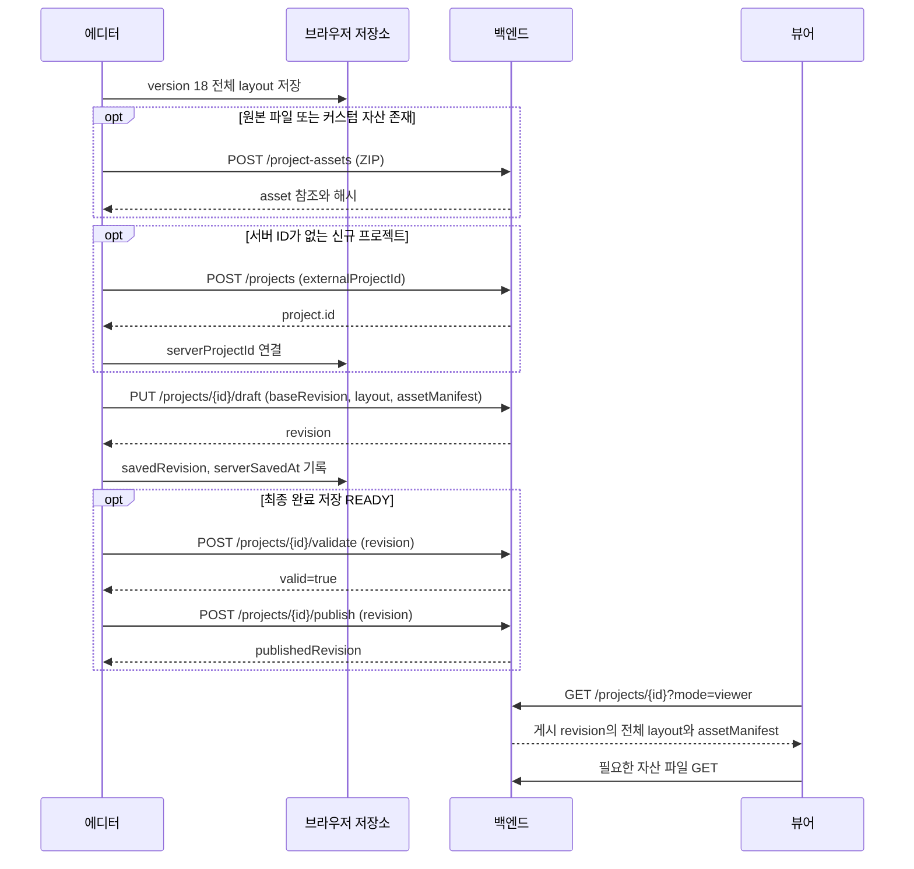

# 프로젝트 편집 저장·뷰어 반영·삭제 연동 계약

작성일: **2026-11-19** · 대상: DigitalTwin 프론트와 `/api/v1` 백엔드 개발자

이 문서는 **백엔드 전달용 단일 문서**다. 아래 주소, 요청·응답, 저장 규칙, 파일 계약, 삭제 정책, 오류 처리와 인수 조건을 함께 구현하면 현재 프론트의 프로젝트 생명주기와 연결된다. 다른 문서의 링크는 참고 자료이며, 연결에 필요한 핵심 계약은 이 문서 안에 포함했다.

## 1. 현재 구현 상태와 작업 범위

| 기능 | 프론트 현재 상태 | 백엔드 확인/구현 사항 |
|---|---|---|
| 프로젝트 생성 | 구현됨: `POST /projects` | 기존 전달 계약의 API. 실제 저장·응답 확인 필요 |
| 편집 내용 저장 | 구현됨: `PUT /projects/{id}/draft` | 전체 layout을 불변 revision으로 영속 저장 |
| 뷰어 반영 | 구현됨: `POST /validate` → `POST /publish` | 검증한 revision의 게시 포인터를 원자적으로 변경 |
| 편집/뷰어 조회 | 구현됨: `GET /projects/{id}?mode=editor|viewer` | 각각 최신 초안/게시본을 반환 |
| 원본 자산 파일 | 프론트 ZIP 업로드·복원 구현됨 | `/project-assets` 및 `NATIVE_BUNDLE` 지원 필요. 서버 지원은 미확인 |
| 프로젝트 삭제 | 이번 변경에서 DELETE 요청·확인창·서버 성공 후 로컬 정리 구현 | **신규 `DELETE /projects/{id}` 구현 필요**. 기존 백엔드 전달 문서에는 없었음 |
| 리스트 이미지 | 행 높이 112px, 이미지 contain, 확대 팝업 | 별도 API 없음. 목록의 `thumbnailUrl` 또는 로컬 저장 사진 사용 |

이 저장소는 React/Vite 프론트이며 해당 `/api/v1` 서버 구현을 포함하지 않는다. 이 문서는 **서버 코드가 배포되었다는 보고가 아니다**. 저장·게시 경로는 기존 백엔드 전달 계약이고, 삭제·원본 자산 확장은 프론트가 호출할 구체적 구현 요구사항이다. 테스트의 모의 서버 응답 통과와 운영 서버의 영속 저장 성공은 구분한다.

## 2. 주소·인증·HTTP 공통 규칙

```dotenv
VITE_PROJECT_API_BASE=https://checklab.co.kr/api/v1
```

- 값은 `/api/v1`까지 포함하고 마지막 `/`는 프론트가 제거한다. Vite 환경 변수는 빌드 시 반영한다.
- 위 값이 없고 `VITE_MONITORING_API_BASE`가 `/api/fe/v1`로 끝나면 같은 호스트의 `/api/v1`을 사용한다. 둘 다 없으면 로컬 전용이다.
- 아래 경로는 모두 기본 주소 뒤에 붙는다. `/configuration`, `/viewer`, 프로젝트 `/assets`라는 별도 경로로 바꾸지 않는다.
- JSON 쓰기: `Content-Type: application/json`. 읽기·DELETE에는 JSON 본문과 Content-Type이 없다.
- `fetch`는 `credentials: "same-origin"`, `cache: "no-store"`다. 자동 Authorization 토큰, 교차 출처 쿠키 전송은 없다. 현재 데모 로그인은 API 인증 토큰이 아니다.
- 인증을 붙일 경우 같은 출처의 `/api/v1` 리버스 프록시/세션을 사용하거나 프론트 인증 계약을 함께 변경해야 한다. 서버에서 권한 검사는 반드시 실제 인증 주체에 대해 수행한다. 프론트의 local ID만으로 접근 권한을 인정하지 않는다.
- 다른 출처에서는 배포 프론트 Origin을 CORS 허용 목록에 등록한다. OPTIONS, GET, POST, PUT, DELETE와 Content-Type을 허용한다. CORS 실패도 프론트에서는 네트워크 실패로 보인다.
- JSON 요청 제한 시간 30초, 원본 자산 업로드/다운로드 120초. 클라이언트 취소는 서버 트랜잭션의 롤백 완료를 의미하지 않는다.
- 조회는 `Cache-Control: no-store`로 응답한다. 게시·삭제 뒤 CDN/프록시가 이전 목록·뷰어를 반환하면 안 된다.

성공 응답은 HTTP 200/201과 다음 외피를 사용한다. **`data`는 객체**여야 한다.

```json
{"request_id":"trace-uuid","data":{"projectId":"server-uuid","revision":1}}
```

실패 응답은 적절한 HTTP 오류 코드와 다음 외피를 사용한다. HTTP 200 안에 error를 넣지 않는다.

```json
{"request_id":"trace-uuid","error":{"code":"REVISION_CONFLICT","message":"다른 편집 내용이 저장되었습니다.","details":{"currentRevision":4}}}
```

삭제 성공의 **204 No Content는 예외**로 JSON을 보내지 않는다. 프론트는 오류의 `message`, `code`, HTTP status를 읽는다. `details`는 백엔드 진단을 위해 추가할 수 있으나 현재 프론트가 자동 병합에 사용하지는 않는다.

## 3. 식별자와 버전: 서로 바꾸지 않는다

| 이름 | 생성 주체 / 의미 | 사용 위치 |
|---|---|---|
| `externalProjectId` | 프론트 프로젝트 ID, text. UUID로 제한하지 않음 | 생성 요청·자산 업로드·로컬/서버 카드 연결 |
| `id`, 요청 경로의 `{id}`, 응답 `projectId` | 서버가 발급한 프로젝트 UUID | draft/validate/publish/GET/DELETE |
| `layout.version` | JSON 구조 버전, 현재 **18** | 스키마 호환 검사 |
| `revision` | 프로젝트별 저장 순번, 최초 저장 1 | 편집 조회·초안 저장 결과 |
| `baseRevision` | 클라이언트가 마지막으로 저장/조회한 revision | 낙관적 잠금. 최초 저장 0 |
| `publishedRevision` | 공개 뷰어가 읽는 저장 순번, 미게시 null | 목록·게시 응답 |
| `asset_id` | 서버 원본 ZIP 또는 표시 자산 ID | `assetManifest[]` |
| `equipmentId`, `binding.id`, `assetId`, 센서/ROI ID | layout 내부 원문 식별자 | 타입·접두어·대소문자·참조를 그대로 보존 |

로컬 레지스트리는 `digital-twin-projects-v1`, 현재 편집본은 `digital-twin-editor-layout`에 저장한다. `serverProjectId`로 서버 UUID를 연결한다. 프로젝트를 생성했다고 로컬 ID를 서버 UUID로 치환하거나 layout 안의 설비 ID를 재발급하면 안 된다.

## 4. 실제 프론트 호출 순서



- 일반 목록 복귀는 `DRAFT` 저장이다. 마지막 설정 완료 후 저장은 `READY`이며 validate/publish까지 호출한다. 미완료 설비 단계가 있으면 DRAFT로 저장한다.
- **초안 저장만으로 게시본을 바꾸지 않는다.** revision 5가 게시된 상태에서 초안 6을 저장하면 editor는 6, viewer는 5를 반환한다. 6의 publish 성공 뒤 viewer가 6을 반환한다.
- 자산 업로드가 프로젝트 생성보다 먼저 실행될 수 있다. 업로드는 `externalProjectId`로 접수할 수 있어야 한다.
- API 미설정이면 로컬 저장만 수행한다. 서버 연결 실패 시에도 먼저 성공한 로컬 저장은 유지된다. 현재 저장 흐름은 서버 실패 뒤에도 목록으로 돌아갈 수 있으므로 **목록에 카드가 보인다는 사실은 서버 저장 성공 증거가 아니다**.
- 자동 재시도·충돌 자동 병합·서버 강제 덮어쓰기는 하지 않는다. 쓰기 성공 응답이 유실되면 실제 서버 revision을 조회해 조정해야 한다.
- 이미 열린 뷰어에 새 구성을 밀어 넣는 실시간 구성 이벤트는 없다. 게시 후 뷰어를 다시 열거나 새로고침하면 게시본을 조회한다. 센서 WSS는 구성 게시 이벤트가 아니다.

## 5. 프로젝트 생성

`POST /projects`

```json
{
  "name":"1동 수배전반",
  "scope":"SINGLE_EQUIPMENT",
  "externalProjectId":"local-project-001",
  "clientRequestId":"ec1292ce-5e6b-4dd6-b934-80cd510e7c11"
}
```

`scope`: `SITE | BUILDING | SINGLE_EQUIPMENT | MULTI_EQUIPMENT | CUSTOM`.

```json
{
  "request_id":"trace-create",
  "data":{"project":{"id":"9543f04b-c357-4c20-919c-0fbbe1d5ff5f","externalProjectId":"local-project-001","name":"1동 수배전반","scope":"SINGLE_EQUIPMENT","revision":0,"publishedRevision":null}}
}
```

생성 요청에는 layout이 없다. 초기 revision=0, 게시본=null이다. 같은 소유권 범위의 externalProjectId로 재생성할 경우 기존 프로젝트를 반환해 중복 프로젝트를 만들지 않는다. 삭제된 ID에 대한 생성은 409 `PROJECT_DELETED`로 거절하고 새 프로젝트 ID를 사용하게 한다. 최초 draft가 아직 없는 revision 0 프로젝트는 일반 목록에서 제외하는 것을 이 계약의 기본 정책으로 한다. 현재 편집기 조회는 revision 1 이상과 layout을 필요로 한다.

## 6. 편집 내용 전체 저장

`PUT /projects/{서버 UUID}/draft`

```json
{
  "baseRevision":0,
  "layout":{
    "version":18,
    "savedAt":"2026-11-19T01:00:00.000Z",
    "name":"1동 부지",
    "projectStatus":"DRAFT",
    "hierarchy":{"rootId":"SITE_MAIN","activeRoomId":null,"selectedNodeId":"SITE_MAIN","nodes":[{"id":"SITE_MAIN","type":"SITE","name":"부지","parentId":null}]},
    "observationWorkflow":{"configured":true,"scopeType":"SITE"},
    "viewerPreset":{},
    "representativeImage":null,
    "siteEnvironment":{"width":40,"depth":40,"sizeMode":"MANUAL","groundMaterial":"CONCRETE","backgroundTheme":"LIGHT","terrain":null},
    "sitePaths":[],
    "siteObjects":[],
    "gridSettings":{},
    "roomScenes":{},
    "floorPlansById":{},
    "verticalStructuresByBuildingId":{},
    "equipmentByFloorId":{},
    "equipmentAssetBindings":[],
    "sensorBindings":[],
    "observationPoints":[],
    "serverBindings":[],
    "observationConfig":{"equipmentAssetBindings":[],"sensorBindings":[],"observationPoints":[],"serverBindings":[]}
  },
  "assetManifest":[],
  "clientRequestId":"170c2c45-693b-471e-92d3-5bf744567a11"
}
```

위 JSON은 **전송·보존 확인용 최소 초안 예제**다. 모든 모델/센서 옵션과 게시 검증을 통과하는 생산용 프로젝트 예제가 아니다. 실제 요청은 프론트 `serializeLayout()`이 만든 전체 객체이며, 서버는 위 예제의 키만 골라 저장해서는 안 된다.

```json
{"request_id":"trace-save","data":{"projectId":"9543f04b-c357-4c20-919c-0fbbe1d5ff5f","revision":1}}
```

### 저장 규칙

1. 프로젝트 권한·삭제 여부를 확인한다. 삭제와 저장은 같은 프로젝트 행 잠금으로 직렬화한다.
2. `baseRevision`은 0 이상의 정수이며 현재 초안 revision과 같아야 한다. 다르면 409 `REVISION_CONFLICT`다. 최초 초안 없음은 0으로 비교한다.
3. 새로운 revision = 기존 revision + 1. 전체 layout과 assetManifest를 동일 트랜잭션으로 저장한다. 기존 revision을 수정하지 않는다.
4. `name`, `scope`, `updatedAt` 목록 메타데이터도 최신 layout과 동기화한다. `updatedAt`은 서버 저장 시각이다. `layout.savedAt` 원문을 서버 시각으로 덮어쓰지 않는다.
5. `layout.projectStatus`의 DRAFT/READY는 편집 완료 상태다. READY라는 값만으로 게시를 승인하지 않는다. publish API가 별도로 필요하다.
6. null, false, 0, 빈 배열, 배열 순서, 객체 키, 미지의 중첩 필드를 보존한다. 검색용 테이블에서 layout을 재조립하지 않는다. JSON 문자열 이스케이프/공백 변화는 허용하지만 수치·문자·구조는 동일해야 한다.
7. `clientRequestId`가 같은 요청은 사용자/작업 범위와 본문 해시가 같으면 이전 결과를 반환한다. 같은 키의 다른 본문은 409 `IDEMPOTENCY_CONFLICT`. 다른 키의 정상 저장은 본문이 같아도 새 revision이다. 프론트가 사용자의 각 새 저장 시도마다 새 UUID를 만든다는 점에 유의한다.

### layout 전체 항목의 보존 위치

| JSON 경로 | 보존해야 하는 내용 |
|---|---|
| `hierarchy` | root/active/selected ID, nodes의 부모 관계·건물 층 정보 |
| `observationWorkflow` | 범위·configured·단계·viewerSettings와 중첩 옵션 |
| `siteEnvironment`, `sitePaths`, `siteObjects`, `gridSettings` | 부지·지형·재질·객체 변환·격자 |
| `roomScenes[roomId]` | 방 내부 설비·detailAssets·장면 전체 |
| `floorPlansById[floorId]`, `verticalStructuresByBuildingId[buildingId]` | 평면도·구조물 원문 |
| `equipmentByFloorId[floorId][]` | 설비 치수·변환·metadata·함체·문·슬롯·재질·커스텀 정의 |
| 설비의 `metadata.representativeImage` | 1단계 대표 사진. 프로젝트 대표 사진과 별개 |
| `representativeImage` | 프로젝트 단위 대표 이미지. 로컬 카드에서 우선 사용 |
| `viewerPreset` | 시작 시점·설비별 시점·가상 카메라·조명·표시 옵션 |
| `equipmentAssetBindings[]` | 설비-원본 자산 연결·스캔 정합·실측/외관 표시·좌표 변환 |
| `sensorBindings[]` | 센서 연결·위치·시야·이미지 변환·열화상/초음파 텍스처·보정 |
| `observationPoints[]` | ROI 형상·대상 설비·측정 항목·판정 기준·좌표계 |
| `serverBindings[]` | 서버 데이터 연결 설정 |
| `observationConfig` | 위 4개 binding/point 배열의 동일 내용 복제 |

각 중첩 객체는 JSON/JSONB 그대로 저장한다. `equipmentByFloorId`와 `roomScenes`의 서로 다른 데이터 위치를 임의 병합하거나 중복으로 판단해 삭제하지 않는다. 최상위 4개 배열과 observationConfig 안의 4개 배열은 같은 값이어야 하며, 다른 요청은 게시 검증에서 실패시킨다.

단위: 일반 장면 위치·크기는 m, rotation은 rad. 카메라 fov·센서 fieldOfView·문 angle은 deg. 모델 정합의 `alignment.unit`은 원본 MM/CM/M 구분이다. 행렬의 저장 순서·벡터 규칙·UV 원점은 각 객체에 저장된 규약을 유지한다. 서버는 표시 단위 cm/mm로 역변환하지 않는다. 런타임 Three.js 객체·objectUrl·undo 기록·실시간 센서 스트림은 이 API의 저장 대상이 아니다. 저장된 미리보기 수치를 실측 데이터로 해석하지 않는다.

### 크기 제한 — 반드시 맞출 항목

- 현재 프론트는 `JSON.stringify(layout)`의 UTF-8 바이트가 **1,048,576 bytes(1MiB)**를 넘으면 요청 전에 거절한다. 서버도 같은 layout 한도를 적용한다. 요청 외피·manifest를 포함한 HTTP body 한도는 이보다 충분히 크게 설정한다(예: 2MiB).
- inline data URL 대표 사진은 이 크기에 포함된다. 사진 업로드 UI의 2MB 제한은 **서버 구성 JSON 1MiB 제한과 별개**다. 사진을 포함한 구성이 1MiB를 넘으면 현재는 로컬에만 저장될 수 있다.
- 이 변경은 기존 서버의 한도를 임의로 늘리거나 사진 전용 업로드 API를 추가하지 않는다. 큰 사진의 별도 영속 참조 전송 또는 JSON 상한 확대는 프론트·백엔드 공동 변경이 필요하다. 이 조건을 해결하지 않고 모든 크기의 사진 저장이 호환된다고 승인하면 안 된다.

## 7. 검증과 게시

`POST /projects/{id}/validate`

```json
{"revision":1}
```

```json
{"request_id":"trace-validate","data":{"valid":true,"issues":[]}}
```

검증 실패는 다음처럼 반환한다. 프론트는 `valid !== true`면 publish를 호출하지 않는다.

```json
{"request_id":"trace-validate","data":{"valid":false,"issues":[{"code":"ASSET_NOT_FOUND","path":"/equipmentAssetBindings/0/assetId","message":"연결된 원본 모델이 없습니다."}]}}
```

검증 대상: version 18, hierarchy ID/부모/순환, 설비·층·방·ROI·센서·카메라 참조, 중복 배열 일치, 자산 소유권/READY 상태/해시, 저장된 좌표계와 기하 제약. 초안은 미완성이어도 보존하되 게시 가능한지 별도 검사한다. 이미 생성된 실제 센서나 운영 장치를 재구성·활성화하는 명령을 여기서 실행하지 않는다.

`POST /projects/{id}/publish`

```json
{"revision":1,"clientRequestId":"66835d56-1c0d-4377-9ada-14e9eaa6bb11"}
```

```json
{"request_id":"trace-publish","data":{"projectId":"9543f04b-c357-4c20-919c-0fbbe1d5ff5f","publishedRevision":1}}
```

서버는 동일 revision와 자산 해시에 대한 검증 성공 여부를 확인한다. validate와 publish 사이에 최신 초안이 달라지면 409 `REVISION_CONFLICT`; 게시 대상이 검증되지 않았으면 422 `VALIDATION_FAILED`. 게시 포인터·시각만 원자적으로 바꾸고 과거 revision의 원문을 수정하지 않는다. 실패하면 이전 게시본을 유지한다. 같은 게시 요청의 재시도는 같은 결과를 반환한다.

## 8. 편집·뷰어 조회 및 목록

`GET /projects/{id}?mode=editor` → 최신 초안.

`GET /projects/{id}?mode=viewer` → 마지막 게시본. 초안 최신값을 자동 반환하지 않는다.

응답의 `layout`에는 6절의 실제 전체 저장 객체, `assetManifest`에는 그 revision과 함께 저장한 배열이 들어간다. 아래에서 layout은 구조 설명을 위해 축약했다.

```json
{
  "request_id":"trace-read",
  "data":{"project":{
    "id":"9543f04b-c357-4c20-919c-0fbbe1d5ff5f",
    "externalProjectId":"local-project-001",
    "revision":1,
    "layout":{"version":18,"hierarchy":{"nodes":[]}},
    "assetManifest":[]
  }}
}
```

`revision`은 반환한 layout 자체의 revision이다. viewer 조회에서 최신 초안 revision을 넣으면 안 된다. 미게시 viewer는 404 `PROJECT_NOT_PUBLISHED`, 없는 프로젝트는 404 `PROJECT_NOT_FOUND`, 삭제된 프로젝트는 410 `PROJECT_DELETED`를 반환한다. 프론트는 version 18·hierarchy.nodes·manifest를 검사하고 파일 복원 후 화면을 연다.

`GET /projects?limit=20&cursor={opaqueCursor}`

```json
{
  "request_id":"trace-list",
  "data":{
    "items":[{
      "id":"9543f04b-c357-4c20-919c-0fbbe1d5ff5f",
      "externalProjectId":"local-project-001",
      "name":"1동 수배전반",
      "scope":"SINGLE_EQUIPMENT",
      "revision":2,
      "publishedRevision":1,
      "createdAt":"2026-11-19T01:00:00Z",
      "updatedAt":"2026-11-19T02:00:00Z",
      "thumbnailUrl":"https://checklab.co.kr/project-images/example.jpg"
    }],
    "nextCursor":null
  }
}
```

- 필수: id/name/scope(비어 있지 않은 문자열), revision(정수), items(배열). publishedRevision은 null 또는 양의 정수, externalProjectId/thumbnailUrl은 문자열 또는 null. nextCursor는 문자열 또는 null이다.
- 날짜는 타임존이 명시된 ISO 8601. 목록은 서버에서 `(updatedAt DESC, id DESC)` 같은 안정적인 순서로 페이지를 제공한다. 프론트는 불러온 서버·로컬 목록을 합쳐 다시 정렬한다.
- 프로젝트명 검색·최근/오래된 수정순·이름순은 현재 불러온 항목에 대한 프론트 처리다. search/sort 파라미터가 서버로 전송된다고 가정하지 않는다.
- thumbnailUrl은 브라우저 ``에서 직접 접근 가능한 영속 주소다. 선택 사항이다. Authorization 헤더를 필요로 하는 이미지 주소는 현재 img에서 자동 인증하지 않는다.
- 로컬 대표 이미지 우선순위: layout.representativeImage → 저장 설비 metadata.representativeImage → 범위별 기본 이미지. 서버 전용 카드는 thumbnailUrl → 기본 이미지다. 서버에서도 같은 사진을 보이게 하려면 저장된 두 경로의 사진에서 썸네일을 생성하고 목록에 URL을 반환한다. 원본 layout을 URL로 임의 치환하지 않는다.

## 9. 원본 파일: 모델·텍스처가 있는 프로젝트의 필수 계약

파일이 없는 도형 기반 프로젝트는 assetManifest=[]로 저장할 수 있다. 업로드한 OBJ/PLY/MTL·이미지·커스텀 정의가 있으면 다음 두 API가 없이는 다른 브라우저에서 복원되지 않는다.

### POST /project-assets

multipart 필드:

| 필드 | 내용 |
|---|---|
| `file` | `project-assets.zip` 바이너리, 최대 512MiB |
| `metadata` | 아래 JSON을 문자열로 보낸 값 |

```json
{"externalProjectId":"local-project-001","format":"digital-twin-assets","version":2,"archive_sha256":"64자리 소문자 SHA-256","clientRequestId":"48a1f5d7-92b0-43d3-a25e-f7cec3bce811"}
```

200/201 응답:

```json
{"request_id":"trace-asset","data":{"asset":{"kind":"NATIVE_BUNDLE","asset_id":"514ac60a-a351-47bb-ad26-c6ca3a49abbb","manifest_sha256":"64자리 project.json SHA-256","archive_sha256":"64자리 ZIP SHA-256"}}}
```

해시 설명 문자열은 예시 자리표시자다. 실제 값은 `[a-f0-9]{64}`이며 서버가 실제 바이트에서 계산해야 한다. manifest_sha256은 **ZIP 안 project.json 원본 바이트**, archive_sha256은 **ZIP 전체 원본 바이트**다. 업로드 ZIP을 서버가 재직렬화/재압축하면 안 된다. 파일 영속 저장·구조 검증 후에만 성공을 반환한다.

ZIP 구조:

```text
project-assets.zip
  project.json
  files/00001-model.obj
  files/00002-material.mtl
  files/00003-front.png
```

project.json 예시(파일 크기는 설명용):

```json
{
  "format":"digital-twin-assets","version":2,"projectId":"local-project-001",
  "assets":{
    "equipment":[{"id":"frontend-asset-1","primaryFileName":"model.obj","primaryFilePath":"model.obj","files":[{"name":"model.obj","path":"model.obj","type":"","size":32,"blob":{"$file":"files/00001-model.obj"}}]}],
    "textures":[],"custom":[]
  },
  "files":[{"path":"files/00001-model.obj","name":"model.obj","size":32,"type":""}]
}
```

- assets.equipment/textures/custom의 원문 키와 내부 ID를 보존한다. layout의 assetId는 이 내부 ID이며 ZIP 전체의 서버 asset_id와 다르다.
- 중첩 Blob 참조는 `{"$file":"files/..."}`. data URL 인코딩은 `{"$file":"files/...","encoding":"data-url","header":"data:image/png;base64","base64":true}` 형식이다. 디코딩 후 같은 data URL 값을 복원한다.
- 상대경로만 허용한다. 절대경로·`..`·역슬래시·중복 경로·암호화·선언되지 않은 파일을 거절한다. project.json.files와 실제 ZIP 엔트리의 크기/CRC/개수/경로를 검증한다.
- 생성은 ZIP STORE, 읽기는 STORE/DEFLATE. 최대 압축 해제 합계 1GiB, project.json 64MiB, 엔트리 10,000개. 원본 ZIP 전송은 512MiB를 넘지 않는다.
- 이 ZIP에는 layout이 없다. 전체 프로젝트 내보내기 ZIP(`digital-twin-project`)과 혼동하지 않는다. layout의 inline 대표 사진은 이 원본 자산 ZIP으로 자동 분리되지 않는다.
- 응답 asset 객체를 **그대로** 다음 PUT draft의 assetManifest 배열에 넣는다. NATIVE_BUNDLE은 최대 1개이며 모든 asset_id는 중복이 없어야 한다.

### GET /project-assets/{asset_id}/file

JSON 외피 없이 업로드 ZIP 원본 바이트를 `Content-Type: application/zip`으로 반환한다. 정확한 Content-Length와 해시 기반 ETag를 권장한다. 리다이렉트/presigned URL 응답은 현재 클라이언트에서 거절한다. 동일 API 경로에서 스트리밍한다. 접근 권한·삭제 프로젝트 참조 상태를 검사한다. 프론트는 ZIP 해시, project.json 해시, CRC, 누락된 자산 의존성을 검사한 뒤 IndexedDB에 복원한다.

기존 DISPLAY_ASSET 지원을 유지하는 서버는 아래도 제공한다. 새 프론트 업로드는 위 NATIVE_BUNDLE을 사용하므로 이 경로를 새 업로드 전송 형식으로 대체할 필요는 없다.

- `GET /display-assets/{asset_id}`: data에 `asset_id`, `manifest_sha256`, `manifest`, `members[]`. manifest는 `format_version:"1.0"`, `asset_id`, `model_member`, `members`, `materials`를 포함한다.
- 각 member는 `member_id`, `kind`, `size_bytes`, `sha256`. `GET /display-assets/{asset_id}/files/{member_id}`는 해당 원본 바이트다.
- manifest 참조는 `{kind:"DISPLAY_ASSET",asset_id,manifest_sha256}`; 기존 kind 생략도 호환된다. layout.equipmentAssetBindings의 `backendAsset.asset_id` 또는 `assetId`가 해당 서버 자산과 연결되어야 한다.

## 10. 신규 프로젝트 삭제 API

`DELETE /projects/{서버 UUID}`. **본문 없음**.

권장 성공: **204 No Content**. 호환 가능한 대체 성공:

```json
{"request_id":"trace-delete","data":{"projectId":"9543f04b-c357-4c20-919c-0fbbe1d5ff5f","deleted":true}}
```

200 응답의 projectId가 요청과 다르거나 deleted가 true가 아니면 프론트는 실패로 처리한다. 202 비동기 접수만으로 삭제 완료를 표시하지 않는다.

### 서버 처리 규칙

1. 삭제 권한을 검사하고 프로젝트 행을 잠근다. 삭제 대상은 서버 프로젝트 전체이며 최신 초안과 모든 게시본의 접근을 함께 중지한다.
2. `deleted_at`을 기록하는 논리 삭제를 권장한다. 과거 revision은 감사/복구 정책에 맞춰 보존할 수 있으나 일반 조회에 노출하지 않는다.
3. 목록에서 즉시 제외하고 editor/viewer GET, draft, validate, publish는 410 PROJECT_DELETED로 거절한다. 직접 뷰어 링크도 더 이상 정상 응답하면 안 된다.
4. 동일 권한 주체의 이미 삭제된 동일 ID 재요청은 204를 반환한다. 네트워크 응답 유실 후 재시도가 안전해야 한다. 전혀 없던 ID는 404, 권한 부족은 403으로 구분한다.
5. 진행 중인 draft/publish와 동일 잠금 규칙을 사용해 삭제 후 재생성을 막는다. 삭제는 현재 서버 프로젝트 전체를 대상으로 하며 프론트가 revision 조건 헤더를 보내지는 않는다.
6. 프로젝트-설비 매핑과 뷰어 접근을 비활성화하되 **공유 센서·함체·운영 측정 이력은 삭제하지 않는다**. 프로젝트 삭제는 장치 해제/정지 명령이 아니다.
7. 자산은 다른 프로젝트/보존 정책의 참조가 없는 경우에만 비동기 GC한다. 삭제 트랜잭션 안에서 공유 Blob을 즉시 지우지 않는다. 삭제된 프로젝트에서만 참조되던 비공개 자산은 즉시 접근을 막는다.
8. 서버/프록시 캐시를 무효화한다. 이미 다운로드한 다른 브라우저의 오프라인 사본까지 서버 삭제로 회수할 수 있는 것은 아니다.

### 프론트 처리 규칙

- 서버 연결 프로젝트는 더보기 → **프로젝트 삭제** → 삭제 범위 확인 → DELETE.
- 서버 ID가 없는 로컬 프로젝트 또는 API 미설정 환경에서는 **로컬 삭제**만 수행한다. 확인창에서 브라우저 저장본만 삭제한다고 안내한다.
- 서버 성공 전에는 localStorage 프로젝트·ROI를 삭제하지 않는다. 네트워크/권한/404/409/5xx 실패 시 서버 삭제를 로컬 성공으로 대체하지 않는다.
- 서버 성공 후 서버 목록 항목을 제거하고, 같은 serverProjectId/서버 ID/선택한 로컬 ID로 연결된 이 브라우저 사본과 ROI를 정리한다. 다른 프로젝트는 유지한다. 공유 IndexedDB 모델 파일을 무조건 삭제하지 않는다.
- 서버 성공 후 로컬 정리가 실패하면 확인창에 둘을 구분해 표시한다. 같은 창에서 재시도하면 로컬 정리만 진행한다.
- 동기화된 서버 뷰어의 401/403/404/410은 캐시 뷰어로 대체하지 않는다. 네트워크 장애 시의 기존 로컬 복구는 유지한다. 사용자가 별도로 보유한 로컬 편집본은 서버 조회 실패만으로 삭제하지 않는다.

## 11. DB 구현 지침

아래는 DB 제품과 무관한 최소 논리 모델이다. 기존 테이블이 있으면 이름을 바꾸기보다 동일 제약을 적용한다. PostgreSQL JSONB 또는 MySQL JSON과 별도 원문 저장을 사용할 수 있다. 검색용 분해 테이블은 필수가 아니다.

| 테이블 | 필수 내용·제약 |
|---|---|
| projects | id PK, owner/tenant, external_project_id, name, scope, draft_revision(없음=0), published_revision(nullable), thumbnail_url, created_at, updated_at, deleted_at. `(owner,external_project_id)` 유일 |
| project_revisions | `(project_id,revision)` PK, layout_version=18, layout_json 전체, 원문/해시(감사 필요 시), asset_manifest_json 전체, validation_json, saved_at. revision 불변 |
| assets | id PK, owner, kind, archive_sha256, manifest_sha256, object_key, byte_size, READY 상태, 생성 시각. 원본 바이트 불변 |
| revision_assets | `(project_id,revision,ordinal)` PK, asset_id FK, reference_json 원문. 순서 보존 |
| api_requests | `(owner,operation,client_request_id)` 유일, request_hash, response_status/body. 같은 키 다른 본문 거절 |

프로젝트가 특정 revision을 가리키는 FK는 `(project_id,revision)` 두 값으로 연결한다. 자산 내부의 frontend ID를 전역 UUID FK로 강제하지 않는다. 기존 `docs/viewer/schema/viewer-configuration-schema.sql`을 사용하는 경우 dt_project에 `deleted_at`과 소유권 정책을 추가하고, 모든 조회에 삭제 조건을 적용해야 한다. 그 SQL은 제안 스키마이며 운영 적용 이력이 아니다.

트랜잭션 의사 코드:

```text
saveDraft:
  BEGIN
  권한 검사; 같은 clientRequestId 결과가 있으면 동일 본문 확인 후 재사용
  SELECT project FOR UPDATE; deleted_at이면 410
  baseRevision != draft_revision이면 409
  manifest 소유권/존재/해시와 JSON 형식 검사
  INSERT immutable revision (draft_revision + 1, whole layout, whole manifest)
  UPDATE project draft_revision, name, scope, updated_at
  저장 결과와 멱등성 기록을 함께 COMMIT

publish:
  BEGIN; SELECT project FOR UPDATE; deleted_at이면 410
  요청 revision = 최신 draft이고 해당 revision의 검증 성공 확인
  UPDATE published_revision, published_at; 멱등성 결과와 COMMIT

delete:
  BEGIN; SELECT project FOR UPDATE; 권한 확인
  이미 deleted_at이면 COMMIT 후 204
  UPDATE deleted_at, updated_at; 프로젝트 전용 접근/매핑 비활성화
  COMMIT; 캐시 무효화; 204
```

## 12. 오류와 재시도 정책

| HTTP | error.code 예시 | 의미 / 프론트 기대 |
|---|---|---|
| 400 | INVALID_REQUEST, INVALID_LAYOUT | 잘못된 JSON/형식/ID. 로컬 유지 |
| 401 / 403 | UNAUTHENTICATED, FORBIDDEN | 인증/권한 필요. 로컬 캐시로 서버 뷰어 권한을 우회하지 않음 |
| 404 | PROJECT_NOT_FOUND, PROJECT_NOT_PUBLISHED, ASSET_NOT_FOUND | 없는 리소스/게시본. 삭제 성공으로 취급하지 않음 |
| 405 / 501 | METHOD_NOT_ALLOWED, NOT_IMPLEMENTED | 신규 API 미지원. 서버에서 구현 후 재시도 |
| 409 / 412 | REVISION_CONFLICT, IDEMPOTENCY_CONFLICT | 저장/게시 충돌. 자동 강제 덮어쓰기 없음 |
| 410 | PROJECT_DELETED | 삭제된 프로젝트. 조회·쓰기 금지 |
| 413 | PAYLOAD_TOO_LARGE | JSON/ZIP 상한 초과 |
| 422 | VALIDATION_FAILED, ASSET_HASH_MISMATCH | 참조/기하/파일 검증 실패 |
| 5xx | INTERNAL_ERROR, STORAGE_UNAVAILABLE | 영속 저장 미확정. 성공 응답을 보내지 않음 |

네트워크 오류·30초/120초 초과·브라우저 취소는 서버에 반영되었는지 알 수 없는 상태다. 먼저 조회로 현재 revision/삭제 상태를 확인한다. 프론트의 `clientRequestId`는 자동 재전송 큐가 아니며 사용자의 새 저장 동작은 다른 키를 생성한다.

## 13. 프론트 연결 위치와 검증 방법

| 위치 | 담당 |
|---|---|
| `src/features/digitalTwin/editor/api/layoutRepository.js` | serializeLayout, localStorage 우선 저장 |
| `src/features/digitalTwin/editor/DigitalTwinEditorPage.jsx`의 saveAndReturnToProjects | 자산 → 생성 → draft → READY validate/publish |
| `src/features/portal/projects/projectConfigurationApi.js` | API base, 공통 HTTP/오류, 생성·저장·게시 |
| `projectAssetApi.js`, `projectAssetTransport.js` | ZIP 업로드, manifest 전달, 해시 검사·파일 복원 |
| `projectEditApi.js`, `projectViewerApi.js`, `projectViewerLoader.js` | 초안/게시본 조회, 로컬 복구 정책 |
| `projectDeleteApi.js`, `ProjectsPage.jsx`, `ProjectDeleteDialog.jsx` | DELETE 요청·성공 검증·확인창·성공 후 로컬 정리 |
| `projectRepository.js` | 로컬 ID ↔ 서버 ID, revision, 프로젝트별 저장본 |
| `ProjectThumbnail.jsx`, `ProjectsPage.module.css` | 112px 리스트 행, 확대 미리보기. 저장 데이터는 변경하지 않음 |

로컬 검증 명령:

```sh
node --test tests/projectConfigurationApi.test.js tests/projectDeleteApi.test.js tests/projectLifecycleApi.test.js tests/projectAssetsIntegration.test.js tests/localViewerPersistence.test.js tests/projectRepository.test.js tests/projectListView.test.js
npm run build
```

projectLifecycleApi 테스트는 모의 응답으로 초안/게시 분리, 서버 UUID, JSON 보존, 삭제 후 조회 실패를 검증한다. 원본 파일 왕복은 projectAssetsIntegration 테스트에서 검증한다. 이 테스트들은 실제 백엔드 DB·스토리지·인증·CORS를 검증하지 않는다.

## 14. 백엔드 인수 체크리스트

1. 신규 프로젝트를 실제 에디터에서 저장하고 네트워크의 externalProjectId와 반환된 서버 UUID를 기록한다. DB의 이름/범위/revision과 일치한다.
2. 위치·치수·문 설정·시작 카메라·대표 사진·센서/ROI/이미지 보정을 포함한 **실제 전체 layout**을 저장한다. editor GET과 구조적으로 비교해 필드 손실이 없다.
3. revision 1 게시 → 초안 2 저장. editor=2, viewer=1 확인 → 2 검증·게시 → viewer=2 확인. 저장/게시 응답을 성공으로 위장하지 않는다.
4. 같은 baseRevision으로 두 개의 다른 요청을 동시에 보내 하나만 성공하고 나머지는 409다. 동일 clientRequestId의 동일 요청은 같은 결과다.
5. 파일이 있는 프로젝트는 ZIP 원본 바이트와 두 해시를 비교한다. **빈 캐시의 다른 브라우저**에서 게시 뷰어와 편집 화면을 열어 OBJ/PLY/MTL/텍스처/커스텀 모델을 확인한다.
6. 1MiB 초과 layout은 명확한 오류, 로컬 저장 유지. 512MiB 초과 ZIP·해시 불일치·경로 탈출·누락 파일은 거절된다. 대표 사진의 2MB UI 제한과 별도 JSON 제한을 실제 사례로 확인한다.
7. 프로젝트 삭제 확인창 → DELETE → 목록 제거 → 새 브라우저의 직접 링크 410 확인. 기존 게시본/자산 URL 권한과 프로젝트 전용 매핑도 검사한다.
8. 삭제 403/500/네트워크 실패 시 브라우저 사본이 유지된다. 동일 삭제 재요청은 204다. 서버 삭제 성공 후 로컬 저장소 오류를 유발하면 서버/로컬 결과가 구분된다.
9. 공유 자산/함체/센서를 사용하는 다른 프로젝트는 삭제 뒤에도 정상이다. 동시에 들어오는 save/publish가 삭제 프로젝트를 되살리지 않는다.
10. 배포 Origin의 CORS·세션·HTTPS·프록시 body limit·타임아웃을 실제 브라우저에서 확인한다. 목록/뷰어 캐시 때문에 삭제·게시 결과가 지연되지 않는다.

위 확인을 완료한 환경과 서버 배포 버전을 기록해야 운영 호환 검증 완료로 볼 수 있다. 문서 작성·프론트 빌드·모의 테스트만으로 운영 API 구현 완료라고 판단하지 않는다.
