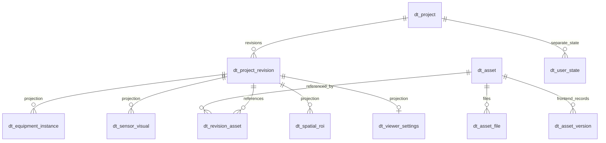

# 에디터·뷰어 전체 JSON 저장 계약과 DB 설계

소스 기준일: **2026-11-17**, 최종 검토일: **2026-11-18**. 현재 작업 트리의 `serializeLayout`, `layout.version = 18` 기준이다. 이 문서는 백엔드 개발자에게 전달할 **구현 제안**이다. 실제 운영 DB를 조회하거나 이 SQL을 실행한 결과가 아니다. 이전 [2026-10 설계](../archive/2026-10/frontend-configuration-database-design.md)보다 현재 프론트의 필드·중첩 구조·저장 경계를 우선한다.

## 1. 구현 목적과 전달 파일

에디터에서 설정한 부지, 건물, 층, 설비, 파일 연결, 센서, 카메라, 관측 영역, 경보 기준을 저장하고, 다른 브라우저에서 다시 조회해 같은 뷰어를 구성해야 한다. **일반 저장은 구성 JSON 저장이다.** 사용자가 에디터 단계마다 ZIP을 업로드하는 절차는 없다. 현재 파일 전송 어댑터가 원본 파일 묶음을 내부적으로 ZIP으로 운반하는 것과, 사용자가 전체 프로젝트를 내보내기/가져오기 하는 기능은 서로 다른 기능이다.

| 파일 | 용도 |
|---|---|
| 이 문서 | 전체 구조, DB 매핑, 저장·조회·발행 절차, 누락 방지 기준 |
| [공간 필드](fields/viewer-json-spatial-fields.md) | 최상위 21개, 계층, 부지·지형, 도로, 움직임, 지하, 방, 평면도·계단 |
| [설비·뷰어 필드](fields/viewer-json-equipment-fields.md) | 설비 메타데이터·치수·재질·부품·캐비넷·문, 기준좌표, 조명, 카메라 |
| [관제 필드](fields/viewer-json-monitoring-fields.md) | 파일 바인딩, 센서, 보정, 영상 변환, ROI, 측정 항목·분석·임계치, 서버 연결 |
| [자산 필드](fields/viewer-json-assets-fields.md) | 파일 레코드, 커스텀 설비·포트, 커스텀 건물·블록·연결부·층·그룹 |
| [별도 저장 상태](fields/viewer-json-local-fields.md) | 별도 ROI, 운영 자산·담당자·정비·보고서·알림·개인 설정 |
| [전체 경로 색인](data/viewer-json-field-index.json) | 경로, 자료형/판정 식, 소스 위치, DB 컬럼, JSON Pointer 템플릿, 소스 SHA-256 |
| [템플릿별 전체 기본값](data/viewer-template-catalog.json) | 설비·야외·건축·구조물마다 다른 parameters/variants/materialSlots와 허용 선택지 |
| [PostgreSQL DDL](schema/viewer-configuration-schema.sql) | 구성 원본·리비전·파일·검색용 테이블 및 별도 서비스용 저장 구조 |
| [실제 직렬화 예제](examples/viewer-layout-example.json) | 기본 생성기와 현재 serializer로 만든, 비기본값도 포함한 예제 |
| [파일 API 계약](../integration/backend-viewer-asset-handoff.md) | 파일 업로드/다운로드, manifest, 무결성, 현재 서버의 누락 요구사항 |

필드 사전의 기본값 칸에는 현재 코드의 생성·정규화 식을 그대로 기록했다. `??`, `=== true`, 숫자 제한 등의 차이까지 확인할 수 있다. 소스 조건의 결과가 기능별로 달라지므로, 기본값을 서버의 `DEFAULT`로 일괄 대입하면 안 된다. `JSON (식 참조)`는 JS에서 단일 타입을 강제하지 않는 입력이며, 하위 표와 조건식을 함께 읽는다. 초안 작성 중에는 일부 수치 입력에 빈 문자열이 존재할 수 있다. 초안 보관과 발행 검증을 구분한다.

경로 표기의 `$assets`는 자산 ZIP `project.json.assets`, `$archive`는 해당 `project.json` 전체, `$calibration`/`$imageProcessing`은 각각 별도 API 요청 본문, `$rois`는 별도 ROI 목록, `$operations`/`$registry`는 브라우저 저장 객체를 뜻한다. 실제 JSON에 `$assets` 같은 키를 새로 추가하지 않는다. `{assets|people|tickets}`는 각각에 적용되는 공통 구조다. 예제 JSON은 구조를 보여 주는 초안이며, 모든 선택 기능을 한 프로젝트에 켠 상태나 발행 검증을 통과한 서버 샘플이라는 의미는 아니다.

## 2. 완전 보존의 범위

1. **설정 원본**: 수신한 layout 전체를 `dt_project_revision.layout_json`에 동일한 키·배열 순서·중첩 구조로 보존한다. 각 필드의 실제 DB 자리는 **원본 JSON과 동일한 경로**다.
2. **알려진 필드**: 첨부 사전은 현 코드의 생성·정규화 객체와 UI 추가 필드를 분해한 목록이다. 카탈로그 종속 필드는 `shapeTemplateId`, `type`, `objectDefinitionId`, `materialSlots.id`로 첨부 카탈로그를 조회한다.
3. **열린 객체**: `metadata`, `parameters`, `variants`, `dataBindings`, `intrinsics`, 사용자 자산, `...source`로 통과하는 확장 속성은 임의 키가 가능하다. 유한한 컬럼 목록으로 닫을 수 없으므로 `*`로 표시한 부분까지 원문 JSON을 보존한다. 알지 못하는 키를 DTO에서 삭제하지 않는다.
4. **파일**: JSON의 자산 ID만 저장해서는 모델/텍스처를 복원할 수 없다. 원본 바이너리와 사용자 자산 정의를 함께 저장한다. `blob:` URL, 브라우저 IndexedDB 경로는 서버 파일 주소가 아니다.
5. **현재 미연결 상태**: 브라우저 운영 데이터, 일부 별도 ROI, 임시 편집 상태를 layout의 현재 서버 전송 항목이라고 잘못 설명하지 않는다. 별도 저장용 설계를 제공한다.

`undefined`는 JSON 객체 직렬화 시 빠지고, `null`, `false`, `0`, `""`, `[]`, `{}`는 서로 다른 유효 값이다. 알려진 필드만 골라 새 layout을 재조립하는 방식은 채택하지 않는다. JSONB는 객체 키 순서·공백을 유지하지 않으므로 문자열 해시가 필요하면 `layout_source_utf8`도 함께 보존한다. [PostgreSQL JSON 자료형](https://www.postgresql.org/docs/current/datatype-json.html).

## 3. 최상위 21개 항목의 정확한 위치

아래 모든 행은 기본적으로 `dt_project_revision.layout_json -> '<키>'`에 저장된다. 오른쪽 테이블은 조회·검색을 위한 선택적 복제다. 복제 테이블이 누락되어도 원본 JSON으로 뷰어를 복원할 수 있어야 한다.

| layout 키 | 형태 / 의미 | 검색용 DB 자리 |
|---|---|---|
| `version` | 정수 18 / 프론트 형식 버전 | `dt_project_revision.layout_version` |
| `savedAt` | ISO 문자열 / 프론트 저장 시각 | 원본; 서버 수신 시각 `received_at`과 별도 |
| `name` | trim한 문자열 / 프로젝트명 | `dt_project.name` 동기화 정책 적용 |
| `projectStatus` | 기본 DRAFT / 에디터 상태 | `dt_project_revision.editor_status` |
| `hierarchy` | rootId/activeRoomId/selectedNodeId/nodes | `dt_scene_settings.hierarchy_json`, `dt_scene_node.node_json` |
| `observationWorkflow` | 범위·단계·시작 대상 | `dt_scene_settings.workflow_json` |
| `viewerPreset` | 화면·카메라·조명·표현 설정 | `dt_viewer_settings.preset_json`, `dt_camera_preset.camera_json` |
| `representativeImage` | string 또는 null / 대표 이미지 | 원본; 별도 업로드로 바꿀 경우 API 계약 개정 필요 |
| `siteEnvironment` | width/depth/sizeMode/autoFitBuildingId/groundMaterial/backgroundTheme/terrain | `dt_scene_settings.environment_json` |
| `sitePaths` | 경로 배열, 기본 [] | `dt_scene_node.node_json` (SITE_PATH) |
| `siteObjects` | 야외 오브젝트 배열 | `dt_scene_node.node_json` (SITE_OBJECT) |
| `gridSettings` | 격자/스냅/상세 영역 | `dt_scene_settings.grid_json` |
| `roomScenes` | roomId → 장면 객체 | `dt_room_scene.scene_json` |
| `floorPlansById` | floorId → 평면도 객체 | `dt_floor_plan.plan_json` |
| `verticalStructuresByBuildingId` | buildingId → 구조물 배열 | `dt_vertical_structure.structures_json`, `dt_structure.structure_json` |
| `equipmentByFloorId` | floorId → 설비 배열 | `dt_equipment_instance.instance_json` |
| `observationConfig` | 아래 4개 배열을 담은 객체 | 원본 + 각 검색 테이블 |
| `equipmentAssetBindings` | 표시 자산 연결 배열 | `dt_object_visual.binding_json` |
| `sensorBindings` | 센서 설치·연결·투영 배열 | `dt_sensor_visual.binding_json` |
| `observationPoints` | 관측 영역·측정·분석 배열 | `dt_spatial_roi.roi_json` |
| `serverBindings` | 통신·측정값 연결 배열 | `dt_server_binding.binding_json` |

### 중복과 제외 규칙

- `observationConfig` 안의 4개 배열과 최상위 같은 이름 배열은 **동일 내용**으로 저장한다. serializer는 `observationConfig`를 우선하고, viewer 파서는 최상위 배열을 먼저 읽는 경로가 있다. 서버가 두 값을 다르게 반환하면 안 된다. 저장 요청이 서로 다르면 422와 해당 두 경로를 반환한다. 검색 테이블에는 한 번만 넣는다.
- `equipmentByFloorId`, `roomScenes.*.equipment`, 관제 대상인 `siteObjects`는 서로 다른 소유 경로다. 동일 ID가 있다고 무조건 합치거나 삭제하지 않는다. `source_path`와 리비전을 식별에 포함한다.
- `equipmentAssetBindings[].objectUrl`, `roomScenes.*.detailAssets[].objectUrl`, `gridSettings.gridSize/siteSize/worldGridSize`, `floorPlansById.*.selectedSpatialEntity`는 현재 serializer가 제거한다.
- `hierarchy.selectedNodeId`, `activeRoomId`는 **현재 저장됨**. UI 상태라는 이유로 서버가 임의 삭제하면 안 된다.
- **확인된 프론트 공백**: `sitePaths`는 serializer에 있지만 `useDigitalTwinEditorState`의 `layoutDocument`에 포함되지 않아 일반 저장에서 `[]`가 될 수 있다. 서버가 잃어버린 값으로 복구할 수 없다. 기존 경로 데이터를 사용하는 경우 프론트 연결 보완이 필요하다. 이 문서 작업에서 동작 코드를 수정하지 않았다.

## 4. 모든 하위 값의 DB 위치를 읽는 법

필드 사전의 `equipmentByFloorId.{floorId}[].enclosure.rear.doors[].angle`은 다음과 같이 저장한다.

```sql
-- 배열 인덱스는 0부터. floorId/인덱스는 파라미터이며 SQL 문자열 연결 금지.
SELECT layout_json #> ARRAY[
  'equipmentByFloorId', :floor_id, :equipment_index,
  'enclosure', 'rear', 'doors', :door_index, 'angle'
]
FROM digital_twin_config.dt_project_revision
WHERE project_id = :project_id AND revision = :revision;
```

검색용 설비 행은 `source_path=/equipmentByFloorId/<floorId>/<index>`로 찾으며 `instance_json #> '{enclosure,rear,doors,0,angle}'`이 같은 값이다. 저장한 JSON Pointer의 실제 ID에서는 `~`→`~0`, `/`→`~1`로 이스케이프한다. 인덱스와 원래 배열 순서를 보존한다. JSON의 `{id}` 키를 모두 DB UUID로 강제하지 않는다.

필드 색인의 `storage`는 실제 테이블·컬럼, `rowKey`는 그 행의 식별 조건, `dbJsonPointerTemplate`은 **그 컬럼 내부**의 위치다. `pointerTemplate`은 원래 전달 JSON에서의 경로다. 예를 들어 `$assets.equipment[].primaryFileName`은 `(asset_id, record_kind='equipment', frontend_asset_id=record.id)` 행의 `definition_json` 내부 `/primaryFileName`에 들어간다. 별도 `$calibration` API는 `dt_calibration.payload_json`에, layout 안에 복사된 `sensorBindings[].calibration.payload`는 `dt_project_revision.layout_json`의 해당 중첩 경로에 들어간다. 같은 구조라도 소속에 따라 저장 위치가 다르다.

| 예시 값 | 권위 원본의 자리 | 선택적 검색 자리 |
|---|---|---|
| 설비 제조사 | `layout_json.equipmentByFloorId[floorId][i].metadata.manufacturer` | `dt_equipment_instance.instance_json.metadata.manufacturer` |
| 센서 촬영각 | `layout_json.sensorBindings[i].fieldOfView` 및 동일 observationConfig 경로 | `dt_sensor_visual.binding_json.fieldOfView` |
| 이미지 4점 보정 | `layout_json.sensorBindings[i].textureProjection.perspective.source/target` | 같은 binding_json 하위 경로 |
| ROI 주의 임계치 | `layout_json.observationPoints[i].measurements[j].rules[k].threshold` | `dt_spatial_roi.roi_json.measurements[j].rules[k].threshold` |
| 가상 카메라 시점 | `layout_json.viewerPreset.virtualCameras[equipmentId][i].view` | `dt_camera_preset.camera_json.view` |
| 커스텀 부품 포트 | `project.json.assets.custom[i].parts[j].ports[k]` | `dt_asset_version.definition_json.parts[j].ports[k]` |
| 원본 모델 바이트 | manifest의 파일 참조 경로 | `dt_asset_file.object_key`가 가리키는 object storage |

따라서 원본 JSONB를 저장하는 것은 필드 정의를 생략한다는 뜻이 아니다. **첨부 사전으로 모든 알려진 하위 필드를 정의하고, 그 필드의 보존 자리는 JSONB의 동일 경로로 고정**한다. 검색 빈도가 높은 값만 스칼라 컬럼으로 복제한다. 복제로부터 layout을 재생성하지 않는다.

## 5. 데이터베이스 구조와 관계

첨부 SQL은 별도 `digital_twin_config` 스키마를 사용한다. 기존 업무용 설비/센서 테이블 이름·PK가 확인되지 않았으므로 가상의 운영 FK를 넣지 않았다. 실제 운영 DB와 매핑하려면 `frontend equipmentId`↔`업무 설비 PK`, `serverSensorId`↔`업무 센서 PK` 관계를 따로 확정한다.

| 테이블 | PK / 역할 |
|---|---|
| `dt_project` | project_id; 외부 ID, 이름, 범위, draft/published 포인터 |
| `dt_project_revision` | (project_id, revision); UTF-8 원문, JSONB, 해시, assetManifest, 검증 결과 |
| `dt_asset` | asset_id; DISPLAY_ASSET/NATIVE_BUNDLE의 서버 자산 식별과 해시·상태 |
| `dt_asset_version` | (asset_id, record_kind, frontend_asset_id); equipment/textures/custom 원본 레코드 |
| `dt_asset_file` | (asset_id, member_path); 파일 크기·SHA-256·object_key·메타데이터 |
| `dt_revision_asset` | (project_id, revision, ordinal); manifest 순서와 참조 원문 |
| `dt_api_request` | (actor_scope, operation, request_id); 재시도 중복 처리 방지 |
| `dt_scene_settings` | (project_id, revision); 계층·워크플로·환경·격자 복제 |
| `dt_scene_node` | (project_id, revision, source_path); 계층/야외/기존 경로 항목 |
| `dt_room_scene` | (project_id, revision, room_id); 방 전체 장면 |
| `dt_floor_plan` | (project_id, revision, floor_id); 평면도 전체 |
| `dt_vertical_structure` | (project_id, revision, building_id); 구조물 배열 전체 |
| `dt_structure` | (project_id, revision, source_path); 구조물 개별 검색 행 |
| `dt_equipment_instance` | (project_id, revision, source_path); 설비 인스턴스 검색 |
| `dt_viewer_settings` | (project_id, revision); viewerPreset 전체 |
| `dt_camera_preset` | (project_id, revision, source_path); 가상 카메라 검색 |
| `dt_object_visual` | (project_id, revision, source_path); 파일 연결 검색 |
| `dt_sensor_visual` | (project_id, revision, source_path); 서버 센서 연결 검색 |
| `dt_spatial_roi` | (project_id, revision, source_path); 관측 영역 검색 |
| `dt_server_binding` | (project_id, revision, source_path); 서버 데이터 연결 검색 |
| `dt_calibration`, `dt_image_processing` | 프로젝트/바인딩/자체 revision; 별도 보정·영상 API |
| `dt_roi_record` | 프로젝트/roi_id; layout 외 표면 ROI 서비스 |
| `dt_user_state` | 프로젝트/user_key; 운영 화면·개인 설정의 별도 서버화 제안 |



모든 검색 테이블의 FK는 **(project_id, revision) 두 컬럼**으로 걸어 다른 프로젝트/이전 리비전의 항목을 섞지 않는다. `equipment_id`/`binding_id`만 단독 전역 UNIQUE로 두지 않는다. 자산을 변경할 때는 새로운 불변 자산 ID를 만들고 이전 published 리비전의 자산을 덮어쓰지 않는다.

DDL의 JSON 구조 검사는 `CHECK ((조건) IS TRUE)`를 사용한다. PostgreSQL CHECK는 NULL 결과를 통과시키므로 필수 JSON 경로가 빠진 요청을 단순 비교만으로 차단할 수 없기 때문이다. [PostgreSQL 제약조건](https://www.postgresql.org/docs/current/ddl-constraints.html).

## 6. 설정 JSON 바깥의 API 외피

| 요청/응답 값 | DB 위치 / 의미 |
|---|---|
| POST projects `name`, `scope`, `externalProjectId` | `dt_project.name/scope/external_project_id` |
| 모든 쓰기의 `clientRequestId` | `dt_api_request.request_id`; operation/사용자 범위와 함께 중복 판정 |
| PUT draft `baseRevision` | 현재 draft_revision과 비교하는 조건; layout.version과 무관 |
| PUT draft `layout` | 새 `dt_project_revision` 원본 |
| PUT draft `assetManifest[]` | `asset_manifest_json` 및 순서대로 `dt_revision_asset.reference_json` |
| 응답 `projectId`, `revision`, `publishedRevision` | 서버 UUID, 구성 리비전, 발행 포인터 |
| `configurationId`, `validationScope`, `analysisActivated`, `permissions`, `status`, `validation` 등 서버 응답 | 서버 관리 메타데이터/검증 결과; layout 항목으로 주입하지 않음 |
| `layoutSourceUtf8`, `layoutSha256` 제공 시 | 정확한 원문과 원문 바이트 SHA-256. 재직렬화한 JSONB 문자열로 대체 금지 |

현재 프론트 설정 JSON 크기 한도는 **1 MiB**이다. 파일 바이너리는 이 제한에 포함되는 layout에 넣지 않는다. 대표 이미지가 data URL이면 여전히 layout 크기를 차지한다. API 한도 변경이 필요하면 프론트와 함께 개정한다.

`assetManifest`의 `kind`, `asset_id`, `manifest_sha256`, `archive_sha256` 등은 참조 객체 전체를 보존한다. 상세 파일 ID·버전·텍스처 슬롯은 파일 API 문서와 자산 필드 사전을 따른다. `NATIVE_BUNDLE`의 manifest SHA는 ZIP 자체가 아니라 ZIP 내 `project.json` 바이트의 SHA다. ZIP 전체 SHA와 구별한다.

## 7. 저장·검증·발행·복원 구현 순서

1. 파일 변경이 있으면 파일 업로드를 완료하고 영속 assetId 및 해시를 받는다. 커스텀 자산이 참조하는 하위 자산·텍스처까지 재귀적으로 확보한다.
2. `{baseRevision, layout, assetManifest, clientRequestId}`를 받는다. 인증된 접근 권한과 요청 크기를 검사한다. actor/operation/requestId가 같고 payload 해시가 같으면 이전 응답을 반환하고, 다르면 충돌로 처리한다.
3. 프로젝트 행을 잠그고 baseRevision을 비교한다. 불일치면 409. 신규 프로젝트에서 아직 리비전이 없을 때 frontend baseRevision=0 ↔ DB draft_revision=NULL로 정의한다.
4. 새 리비전에 원문, JSONB, 해시, manifest를 **하나의 트랜잭션**으로 넣고 draft 포인터를 변경한다. 초안 작성 중인 불완전 설정과 발행 가능한 설정을 구분한다. 동일 리비전 덮어쓰기 금지.
5. 발행 검증: hierarchy root/parent/순환/ID, 층·방 소유권, 설비·센서·ROI·카메라 참조, 4개 중복 배열 일치, 자산 존재·무결성, 좌표계/기하·필수 분석 설정을 검사한다. 오류는 JSON Pointer 경로와 code/message를 반환한다.
6. validate 결과가 해당 revision/asset hashes에 대해 유효한 경우만 published_revision을 바꾼다. 최신 초안이 자동 발행되면 안 된다. 기존 발행 리비전과 자산은 유지한다.
7. viewer 조회는 published_revision의 **보존된 전체 layout**과 동일 manifest를 반환한다. 트리 API만으로 layout을 만들어 반환하지 않는다. 새 브라우저에서 자산 다운로드→캐시 복원→뷰어 구성까지 검증한다.

GET published 예시:

```sql
SELECT r.layout_json, r.layout_source_utf8, r.layout_sha256,
       r.asset_manifest_json, r.revision
FROM digital_twin_config.dt_project p
JOIN digital_twin_config.dt_project_revision r
  ON r.project_id=p.project_id AND r.revision=p.published_revision
WHERE p.project_id=:project_id;
```

## 8. 좌표·단위·ID를 변환하지 않는 규칙

| 값 | 저장 규칙 |
|---|---|
| 장면 position/dimensions/평면도/지형 | m, 일반 3D rotation은 rad |
| 센서 fieldOfView, 뷰 카메라 fov, 문 angle | deg |
| 캐비넷 문 u/v/offset, 슬롯 위치 | m; 화면의 cm/mm와 다름 |
| alignment.unit | 원본 모델 단위 MM/CM/M; 스케일·정합 정보를 별도 유지 |
| equipment.metadata.coordinateFrame | m, RIGHT, up=+Y, front=+Z, 길이3 배열 origin/rotation |
| custom building mass.transform.rotationY / section.rotation | deg; 일반 scene rotation.y와 다름 |
| textureProjection 내부 UV | 좌하단 원점; perspective source/target 순서 보존 |
| imageAnalysisTransform v4 / sourceRect/sourceQuad | 좌상단 원점; 정규좌표와 px 둘 다 저장 |
| imageTransform 3×3 | ROW_MAJOR / COLUMN_VECTOR |
| thermalBinding.projector 4×4 | COLUMN_MAJOR / COLUMN_VECTOR |
| 일반 위치 벡터 | `{x,y,z}`와 `[x,y,z]`를 임의 교환하지 않음 |
| geometry-* / frame.version / layout.version / revision | 각각 모델 지문 / 기준좌표 버전 / 형식 버전 / 저장 버전으로 별개 |

## 9. 현재 설정에 포함되지 않는 값

실시간 센서 readings/temperatureGrid/audio/알람 스트림, Three.js mesh/material/camera 객체, objectUrl, 선택 미리보기 ghost, undo/redo 히스토리, 로딩 상태는 별도 런타임 영역이다. 일부 스냅샷·미리보기 값은 **실제로 JSON에 저장**되므로 필드 사전에 별도로 포함했다. 저장된 `previewValue`를 실측값으로 사용하지 않는다.

`digital-twin-operations-v1:<projectId>`의 운영 데이터와 개인 설정은 현재 localStorage에 저장된다. `dt_user_state`는 이를 서버화할 경우의 제안이며 현재 PUT draft로 저장된다고 안내하면 안 된다. 서버 공유가 필요하면 사용자별 설정과 프로젝트 공용 운영 업무를 분리하는 추가 API를 합의한다.

별도 표면 ROI는 `digital-twin-rois-v1:<projectId>` 또는 ROI API에 존재한다. SPHERE/PLANE은 layout observationPoints와 변환되지만, 모든 표면 ROI가 layout에 포함되는 것은 아니다. 일반 파일 자산 ZIP은 layout/별도 ROI를 포함하지 않는다. 전체 프로젝트 내보내기 ZIP은 project/layout/rois/assets를 포함한다.

## 10. 검증과 백엔드 완료 기준

```text
node scripts/generate-viewer-field-reference.mjs
node scripts/generate-viewer-template-catalog.mjs
node scripts/audit-viewer-contract.mjs
node scripts/generate-viewer-field-reference.mjs --check
node scripts/generate-viewer-template-catalog.mjs --check
```

생성기는 객체 정의·정규화 식에서 필드를 추출하고 보충 사전을 합친다. `--check`는 소스 해시/필드/생성 문서가 현재 소스와 일치하는지 검사한다. **모든 런타임 경로가 실행됐다는 증명은 아니다.** 열린 객체 전체 보존 규칙이 별도로 필요한 이유다. 예제 검사는 serializer의 실제 출력, 배열 중복 일치, 제외 필드, false/0/null/확장 키 보존, 필드 색인과 DDL의 테이블 이름을 확인한다. UI 렌더링·운영 DB 마이그레이션·신규 서버 업로드의 E2E 검증과 구분한다.

백엔드 완료 판정에는 다음 실제 왕복 시험이 필요하다.

- 비기본값으로 구성한 각 범위(SITE/BUILDING/SINGLE_EQUIPMENT/MULTI_EQUIPMENT/CUSTOM)를 저장하고 JSON 의미 동등성 비교. unknown sentinel 키, 0/false/null/빈 배열/누락, 한글·ID 내 `/`·`~` 포함.
- 캐비넷 앞뒤 5문, 문별 스캔, GLTF/GLB/OBJ/PLY, 사용자 텍스처, 중첩 커스텀 자산, 카메라 문 상태, 비전 4점 보정, 열화상 ROI, GENERAL/게이지/스위치/LED/밸브 프로필 왕복.
- 로컬 IndexedDB를 비운 새 세션에서 발행본과 모든 파일 다운로드 후 동일 뷰어 복원.
- 실패 업로드/해시 불일치/만료 URL/누락 파일/동시 저장 409/중복 요청/발행 전 초안 분리 확인.
- 별도 ROI 및 운영 서비스가 필요한 경우 해당 API의 저장·조회·권한·충돌도 별도 검증.

이번 전달물은 현재 프론트 계약을 구체화한 문서와 SQL 제안이다. 백엔드에 없던 API를 실제 서버에 구현·배포했다는 의미는 아니다.

### 2026-11-18 문서 검증 결과

- 필드 생성 일치 검사 통과: 최상위 21개, 구조 132종, 별칭·중복 경로를 포함한 필드 사전 항목 3,703개. 서로 다른 고유 필드가 3,703개라는 뜻은 아니다.
- 템플릿 일치 검사 통과: 설비 90, 부지·건축 187, 구조물 73, 재질 34, 바닥 재질 15, 윤곽 9, 커스텀 부품 48개 정의.
- 실제 serializer 예제 왕복 및 자료형 대조 829건 통과. 중복 배열, 제거 대상, 확장 키·false·0·null 보존 확인.
- 문서 링크, 소스 해시, DDL 24개 테이블과 필드 색인의 테이블·컬럼 연결 확인. 운영 PostgreSQL에서 DDL을 실행하거나 신규 백엔드 API·브라우저 뷰어를 시험한 결과는 아니다.
